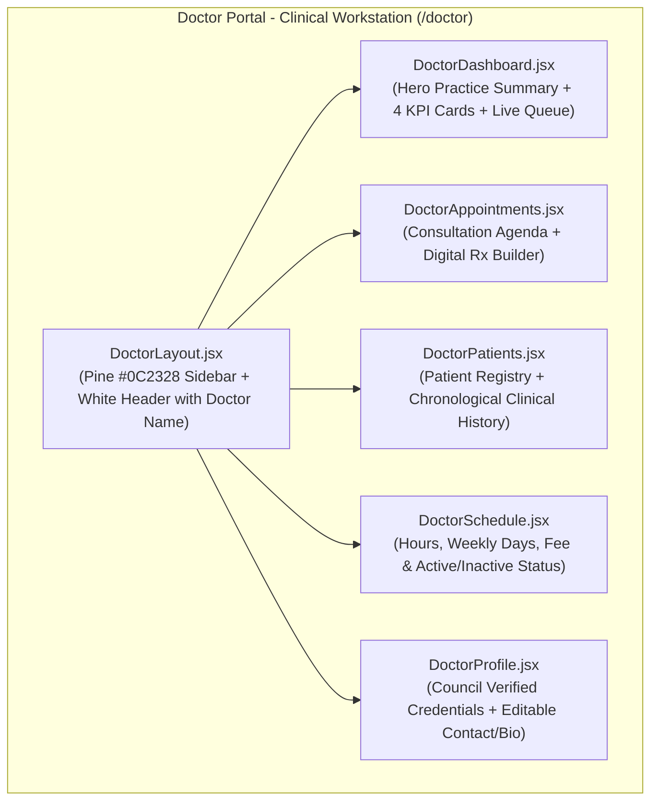

# MediConnect Doctor Portal Complete UI/UX Redesign Report

**Product:** MediConnect Healthcare Platform  
**Subsystem:** Doctor Portal & Clinical Workstation (`/doctor/*`)  
**Lead Architect:** Senior UI/UX Designer & Healthcare Product Architect  
**Implementation Date:** November 12, 2026  
**Status:** Completed & Fully Verified  

---

## 1. Executive Summary & Design System

The MediConnect Doctor Portal has been completely redesigned into a modern, high-density **Clinical Workstation** specifically designed for physicians, specialists, and clinical staff.

### Distinct Visual & UX Identity
To maintain a clear boundary within the platform, the Doctor Portal intentionally diverges from the consumer-focused Patient Portal:
- **Patient Portal (`/patient/*`)**: Consumer healthcare theme utilizing Ocean Blue (`#1677C8`) and Navy (`#102A43`), tailored for booking appointments, exploring specialists, and reviewing personal lab reports.
- **Doctor Portal (`/doctor/*`)**: High-efficiency **Clinical Workstation Theme** utilizing Deep Clinical Pine (`#0C2328`), Emerald Mint (`#0D9488`, `#2DD4BF`), Clean Workstation Slate (`#F8FAFC`, `#FFFFFF`), and crisp triage indicators. It prioritizes patient queues, clinical assessment notes, digital prescriptions, and practice availability.

---

## 2. Component Implementation Details & Recent Refinements

### 2.1 DoctorLayout.jsx
- **Dynamic Authenticated Doctor Name in Header / Navbar**:
  - Replaced the static/redundant breadcrumb (`MediConnect Clinical Workstation / Doctor Profile & Credentials`) with the authenticated doctor's actual name dynamically resolved from `doctorProfile?.name || user?.name`.
  - Intelligently applies the `"Dr."` prefix without duplication (case-insensitive check for existing `"Dr."`, `"Dr"`, or Telugu `"డాక్టర్"`).
  - Consistent across all Doctor Portal routes (`/doctor`, `/doctor/appointments`, `/doctor/patients`, `/doctor/schedule`, `/doctor/profile`).
  - Supports English and Telugu seamlessly.
  - Responsive truncation via CSS `clamp(150px, 36vw, 380px)` and `text-overflow: ellipsis` ensures zero layout overflow on mobile (375px), tablet (768px), and desktop (1440px).
  - Main page headings (such as `Doctor Profile & Credentials`) remain completely intact and unchanged.
- **Cleaned Clinical Sidebar**:
  - Completely removed the Medical Council Certified tag and consultation fee amount (`₹800`) from the sidebar footer.
  - Retained the prominent, well-padded **Sign Out** button at the base of the sidebar.
  - Spacing adjusted cleanly between navigation groups and the logout action.
  - Council certification remains preserved in **Doctor Profile**, and consultation fee remains preserved in **Doctor Schedule** and the database.
- **Top Workstation Bar**:
  - Live doctor name display on the left.
  - In-Clinic availability status chip (`#ECFDF5` / `#065F46`).
  - Hospital facility indicator, integrated `LanguageToggle` (English / Telugu), and physician avatar chip.
  - Fully responsive mobile drawer with backdrop.

### 2.2 DoctorDashboard.jsx
- **Practice Summary Banner**: Deep slate-to-teal gradient displaying physician greeting, medical council verified chip, specialty, affiliated hospital, consultation fee (\$800), date, and quick action buttons.
- **4 Clinical KPI Metric Cards**:
  1. *Today's Appointments*: Active scheduled consultations with triage breakdown (Confirmed, Pending, Completed).
  2. *Total Patients*: Unique patient records treated by this physician.
  3. *All-Time Visits*: Total consultations completed over the practice history.
  4. *Practice Rating*: Verified patient satisfaction rating (e.g., 4.9 ★) with review counts.
- **2-Column Clinical Operations Grid**:
  - *Left Column*: Today's Patient Queue table. If zero today, displays clean queue empty state with link to full consultation agenda. If active, displays time slot, patient name/phone, chief complaint, status, and instant "Consult" / "Confirm" actions.
  - *Right Column*: Quick Clinical Actions (1-click navigation to Consultations, Directory, Schedule, Profile) and Recent Consultations activity feed.
- **Integrated Clinical Consultation & Digital Prescription Builder Modal**:
  - Patient demographics (Age, Gender, Phone, Email, Chief Complaint).
  - Clinical Assessment & Diagnosis notes textarea.
  - Digital Prescription Builder: Medicine Name, Dosage, Frequency (1-0-1, 1-0-0, 1-1-1, SOS), and Timing (After Food / Before Food).
  - Actions to save clinical notes or mark consultation as Completed.

### 2.3 DoctorAppointments.jsx
- **Consultation Agenda Workspace**:
  - Aggregate status pills bar showing real-time counts for All, Pending, Confirmed, Completed, and Cancelled.
  - Search & filter bar: Text search across patient names, phones, emails, and reasons; Status filter; Date filter (All, Today, Upcoming, Past, Custom Date Picker).
  - Interactive Consultations Table: Slot date/time, patient contact details, chief complaint with clinical notes preview, color-coded status badge, and action buttons.
  - Status management: One-click Confirm, Complete, or Cancel with confirmation prompt.
  - Integrated digital prescription and clinical assessment modal.

### 2.4 DoctorPatients.jsx
- **Patient Directory Registry**:
  - Real-time patient count pill and instant debounced search.
  - Patient demographic cards: Initials avatar, full name, phone (with direct call link), email, age, gender, total visits, last visit date, and chief complaint summary.
  - Clinical History Modal: Comprehensive patient profile and chronological timeline of all consultations with Dr. Rajesh Kumar, including past diagnoses, clinical advice, and prescription notes.

### 2.5 DoctorSchedule.jsx
- **Practice Hours & Availability Management**:
  - Practice Availability Status selector (Active vs Inactive/On Leave) with visual cards.
  - Form fields: Weekly Available Days (e.g. *Monday - Saturday*), Daily Working Hours (*09:00 AM - 05:00 PM*), Consultation Modes (*In-Person & Video*, *In-Person Only*, *Video Only*), and Consultation Fee (INR ₹ preserved).
  - Clinical Scheduling Guidelines alert explaining patient booking slot impact.
  - Integrated save action with loading indicators and localized toast notifications.

### 2.6 DoctorProfile.jsx
- **Credentials & Profile Workspace**:
  - Doctor Identity Hero Banner with council certified badge, specialty, hospital affiliation, and experience.
  - Verified Professional Credentials Section: Administrative read-only fields (Full Name, Medical Specialty, Hospital Affiliation, Medical Council Reg No preserved) with regulatory notice.
  - Self-Service Contact & Clinical Biography: Editable contact phone, email, spoken languages (English, Telugu, Hindi), and comprehensive about practice bio.
  - Saves directly to doctor profile with validation.

---

## 3. Bilingual Telugu + English Verification

Every page, table header, button, modal, form input, empty state, and status badge utilizes `translations.js` via the `doctorPortal` dictionary.

| Section / Element | English Key & Label | Telugu Translation |
|---|---|---|
| Navbar Header | Authenticated Doctor Name | డాక్టర్ రాజేష్ కుమార్ / Dr. Rajesh Kumar |
| Dashboard Title | `doctorPortal.dashboardTitle` ("Clinical Practice Dashboard") | క్లినికల్ ప్రాక్టీస్ డ్యాష్‌బోర్డ్ |
| Appointments Title | `doctorPortal.appointmentsTitle` ("Appointments & Consultations") | అపాయింట్‌మెంట్‌లు & సంప్రదింపులు |
| Patient Directory | `doctorPortal.patientsTitle` ("Patients Directory") | రోగుల డైరెక్టరీ |
| Schedule Title | `doctorPortal.scheduleTitle` ("Practice Hours & Availability") | ప్రాక్టీస్ సమయాలు & లభ్యత |
| Profile Title | `doctorPortal.profileTitle` ("Doctor Profile & Credentials") | డాక్టర్ ప్రొఫైల్ & అర్హతలు |
| Sign Out Action | `portalNav.signOut` ("Sign Out") | నిష్క్రమించండి |
| All Consultations | `doctorPortal.allConsultations` ("All Consultations") | అన్ని సంప్రదింపులు |
| Digital Prescription | `doctorPortal.prescriptionTitle` ("Digital Prescription") | డిజిటల్ ప్రిస్క్రిప్షన్ |

**Automated Scan Result**: **0 raw translation keys** across all 5 Doctor Portal routes in both English and Telugu.

---

## 4. Verification & Automated Test Results

### 4.1 Frontend Quality Audits
- **Linter (`oxlint`)**: `0 errors` (exit code 0).
- **Production Build (`vite build`)**: Exit code 0 (`built in 1.02s`).

### 4.2 Backend Pytest Suite
- **Command**: `python -m pytest backend/test_step4_7_doctor_portal.py backend/test_ap_ts_integration.py backend/test_step4_8_patient_portal.py`
- **Result**: **41 passed** in 6.21s with `0 failures`.

### 4.3 Sidebar & Header Visual Checks
- **Navbar Doctor Name**: Correctly renders authenticated doctor name `Dr. Rajesh Kumar` across all Doctor Portal routes.
- **Sidebar Council Badge**: `PASS (Removed from sidebar UI)`.
- **Sidebar Fee Display**: `PASS (Removed from sidebar UI)`.
- **Sidebar Sign Out**: `PASS (Intact and prominent at bottom)`.
- **Mobile Drawer**: `PASS (Drawer opens smoothly, displays navigation and Sign Out)`.
- **Page Headings**: `PASS (Unchanged: "Doctor Profile & Credentials", "Practice Hours & Availability", etc.)`.

---

## 5. Visual QA Screenshots

Captured screenshots in `qa_reports/doctor_portal_redesign/`:
- `doctor_dashboard_desktop_en.png` (247 KB)
- `doctor_dashboard_desktop_te.png` (272 KB)
- `doctor_dashboard_mobile_375.png` (117 KB)
- `doctor_dashboard_mobile_drawer.png` (44 KB)
- `doctor_appointments_desktop_en.png` (117 KB)
- `doctor_patients_desktop_en.png` (105 KB)
- `doctor_schedule_desktop_en.png` (114 KB)
- `doctor_profile_desktop_en.png` (192 KB)

---

## 6. Scope Control & Zero Regressions

1. **Other Portals Unaffected**: Strict preservation of Patient Portal (`/patient/*`), Platform Owner Portal (`/owner/*`), SuperAdmin Portal (`/superadmin/*`), Reception Portal, and Public Home/Welcome pages.
2. **Backend Integrity**: No breaking changes to backend API schemas, database migrations, or authentication logic.
3. **Source Control Cleanliness**: No git commits or pushes executed.
