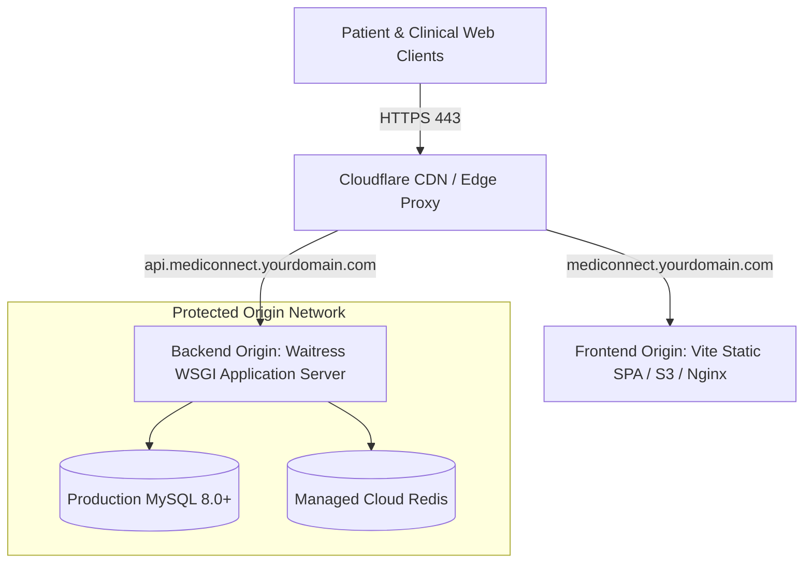

# MediConnect – Public Domain, DNS Architecture & HTTPS/TLS Setup Guide

**Architecture Layer:** Ingress, Public DNS, Reverse Proxy & SSL/TLS Termination  
**Target Environment:** Staging & Production Deployment  
**Security Standard:** Strict TLS 1.3/1.2, HSTS Preload, HTTP $\rightarrow$ HTTPS 301, SameSite Cookies  
**Document Status:** Operational Infrastructure Specification  

---

## 1. Domain & Subdomain Architecture

For a multi-hospital clinical platform, a clear separation between frontend application delivery and backend API communication is architected to optimize caching, CORS isolation, and cookie scoping.



### Domain Routing Scheme
| Hostname / URL | Purpose / Component | Target Destination | SSL/TLS Mode |
| :--- | :--- | :--- | :---: |
| `https://mediconnect.yourdomain.com` | Web App (Patient & Staff Portals) | Production static build (`dist/`) served via Nginx/Cloudflare | Strict TLS 1.3 |
| `https://api.mediconnect.yourdomain.com` | Backend REST API & WebSockets | Waitress WSGI Application Server (Port 5000) | Strict TLS 1.3 |

---

## 2. Standard DNS Records Configuration

Configure the following DNS resource records with your authoritative domain registrar (Cloudflare, AWS Route 53, or Namecheap):

| Record Type | Host / Name | Target Value | Proxy Status | Recommended TTL |
| :--- | :--- | :--- | :---: | :---: |
| **A / CNAME** | `mediconnect` | `<PRODUCTION_FRONTEND_SERVER_IP>` or CDN CNAME | Proxied (Orange Cloud) | 300s (Cutover) / Auto |
| **A / CNAME** | `api.mediconnect`| `<PRODUCTION_BACKEND_SERVER_IP>` | Proxied (Orange Cloud) | 300s (Cutover) / Auto |
| **TXT** | `_dora` / `@` | `v=spf1 include:... ~all` | DNS Only | 3600s |
| **CAA** | `@` | `0 issue "letsencrypt.org"` / `0 issue "digicert.com"` | DNS Only | 3600s |

> [!WARNING]
> **Explicit User Approval Required:**
> Do not purchase domains, alter registrar nameservers, or modify external DNS zone files without explicit confirmation from the domain owner.

---

## 3. Reverse Proxy & Ingress Routing (Nginx Configuration)

The following production Nginx configuration terminates TLS, redirects HTTP to HTTPS, applies security headers, and proxies API traffic to Waitress:

```nginx
# =============================================================================
# MediConnect Production Nginx Reverse Proxy Configuration
# File: /etc/nginx/sites-available/mediconnect.conf
# =============================================================================

# 1. HTTP to HTTPS 301 Permanent Redirect
server {
    listen 80;
    listen [::]:80;
    server_name mediconnect.yourdomain.com api.mediconnect.yourdomain.com;
    return 301 https://$host$request_uri;
}

# 2. Frontend Application (Single Page Application)
server {
    listen 443 ssl http2;
    listen [::]:443 ssl http2;
    server_name mediconnect.yourdomain.com;

    # SSL Certificates (Automated via Certbot / Cloudflare Origin)
    ssl_certificate /etc/letsencrypt/live/mediconnect.yourdomain.com/fullchain.pem;
    ssl_certificate_key /etc/letsencrypt/live/mediconnect.yourdomain.com/privkey.pem;
    ssl_protocols TLSv1.2 TLSv1.3;
    ssl_ciphers HIGH:!aNULL:!MD5;
    ssl_prefer_server_ciphers on;

    # Hardened Security Headers
    add_header X-Frame-Options "SAMEORIGIN" always;
    add_header X-Content-Type-Options "nosniff" always;
    add_header X-XSS-Protection "1; mode=block" always;
    add_header Referrer-Policy "strict-origin-when-cross-origin" always;
    add_header Strict-Transport-Security "max-age=31536000; includeSubDomains; preload" always;

    root /var/www/mediconnect/frontend/dist;
    index index.html;

    # Static SPA Routing (Fallback to index.html for client-side routing)
    location / {
        try_files $uri $uri/ /index.html;
    }

    # Static Assets Caching
    location ~* \.(?:ico|css|js|gif|jpe?g|png|woff2?|eot|ttf|svg)$ {
        expires 6M;
        access_log off;
        add_header Cache-Control "public, max-age=15552000, immutable";
    }
}

# 3. Backend REST API Application
server {
    listen 443 ssl http2;
    listen [::]:443 ssl http2;
    server_name api.mediconnect.yourdomain.com;

    ssl_certificate /etc/letsencrypt/live/api.mediconnect.yourdomain.com/fullchain.pem;
    ssl_certificate_key /etc/letsencrypt/live/api.mediconnect.yourdomain.com/privkey.pem;
    ssl_protocols TLSv1.2 TLSv1.3;

    # Hardened Security Headers
    add_header X-Content-Type-Options "nosniff" always;
    add_header Strict-Transport-Security "max-age=31536000; includeSubDomains" always;

    # Proxy to Waitress Application Server
    location / {
        proxy_pass http://127.0.0.1:5000;
        proxy_http_version 1.1;

        # Forward Ingress Protocol Headers for ProxyFix
        proxy_set_header Host $host;
        proxy_set_header X-Real-IP $remote_addr;
        proxy_set_header X-Forwarded-For $proxy_add_x_forwarded_for;
        proxy_set_header X-Forwarded-Proto $scheme;
        proxy_set_header X-Forwarded-Host $host;
        proxy_set_header X-Forwarded-Port $server_port;

        # Timeouts for clinical PDF generation and queries
        proxy_connect_timeout 60s;
        proxy_read_timeout 120s;
        proxy_send_timeout 120s;
    }
}
```

---

## 4. HTTPS/TLS Enforcement & ProxyFix Settings

In `backend/config.py` and `backend/wsgi.py`, the backend is already instrumented with `ProxyFix` middleware to safely consume headers from Nginx or Cloudflare without IP spoofing:

```python
# In backend/wsgi.py:
if Config.TRUST_PROXY_HEADERS:
    from werkzeug.middleware.proxy_fix import ProxyFix
    app.wsgi_app = ProxyFix(
        app.wsgi_app,
        x_for=Config.PROXY_FIX_X_FOR,
        x_proto=Config.PROXY_FIX_X_PROTO,
        x_host=Config.PROXY_FIX_X_HOST,
        x_port=Config.PROXY_FIX_X_PORT,
        x_prefix=Config.PROXY_FIX_X_PREFIX
    )
```

### Environment Configuration:
```bash
TRUST_PROXY_HEADERS=true
PROXY_FIX_X_FOR=1
PROXY_FIX_X_PROTO=1
PROXY_FIX_X_HOST=1
PROXY_FIX_X_PORT=0
PROXY_FIX_X_PREFIX=0
```

---

## 5. CORS & Origin Hardening

To prevent cross-site request forgery and unauthorized API invocations from external origins:
1. **Zero Wildcard Policy:** In production (`FLASK_ENV=production`), `*` wildcard origins are forbidden.
2. **Explicit Whitelist:** Only the exact frontend origin(s) are permitted:
   ```bash
   ALLOWED_ORIGINS=https://mediconnect.yourdomain.com,https://admin.mediconnect.yourdomain.com
   ```
3. **Pre-Flight Validation:** All unwhitelisted origins receive HTTP 403 / CORS Pre-Flight Block.
4. **Endpoint Exposure Audit:** Verified that all clinical, patient, and administrative endpoints require `Authorization: Bearer <jwt_token>`. Unauthenticated requests to `/api/owner/*`, `/api/superadmin/*`, `/api/hospital-admin/*`, `/api/doctor/*`, `/api/patient/*`, and `/api/prescriptions/*` are rejected with HTTP 401.
