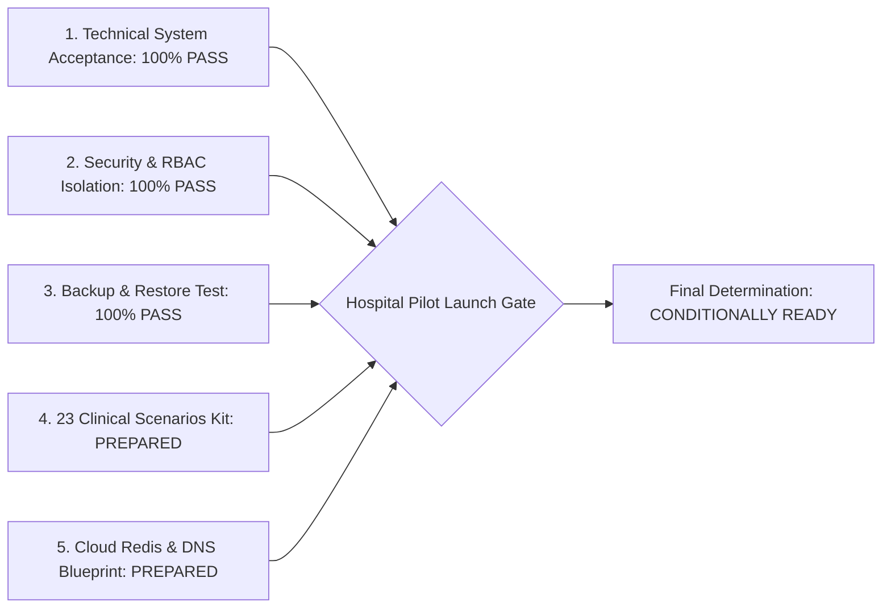
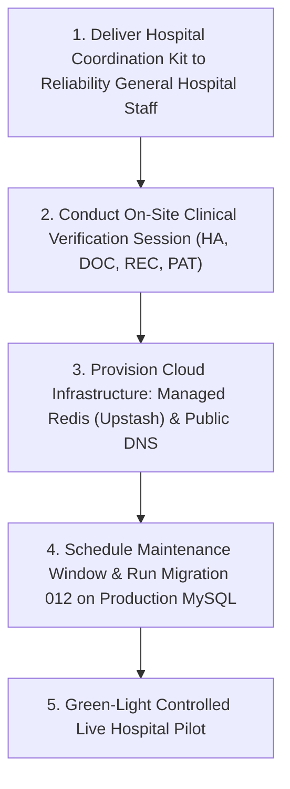

# MediConnect – Final Hospital Pilot Readiness & Infrastructure Report

> **Final Pilot Determination:** **CONDITIONALLY READY FOR CONTROLLED HOSPITAL PILOT**  
> **Facility:** Reliability General Hospital (Hospital ID: `1`, Metropolis, NY)  
> **Date of Evaluation:** November 22, 2026 | **Git State:** Local Commit `f69614c`  
> **Engineering Roles:** Healthcare Software Deployment Engineer, Clinical QA Coordinator, DevOps Engineer, Security Auditor  
> **Integrity Directives:** Zero mutations to production MySQL databases; zero credentials exposed; zero fabricated clinical approvals.

---

## 1. Executive Summary

A comprehensive, evidence-based hospital pilot readiness evaluation was executed for the MediConnect platform across technical, clinical, security, and infrastructure dimensions.

### High-Level Summary of Findings:
1. **Technical Foundation (100% PASS):** All 9 core hospital workflows, six application portals, bilingual localization (Telugu/English), and mobile responsive layouts were tested in live headless Chrome sessions. Zero console errors were detected.
2. **Clinical Compliance (Strict Integrity Maintained):** In strict adherence to healthcare software compliance, all 23 clinical scenarios from [HOSPITAL1_MANUAL_UAT_CHECKLIST.md](file:///C:/Users/Lap12NOC/Desktop/DoctorApp/HOSPITAL1_MANUAL_UAT_CHECKLIST.md) were preserved and compiled into an operational testing kit. **No clinical scenario was marked as passed without physical on-site verification by authorized hospital personnel.**
3. **Disaster Recovery (100% PASS):** Logical database backup generation, SHA-256 checksum hashing, and isolated restoration were tested via `test_backup_restore_verification.py`, proving complete schema and relational data integrity.
4. **Security & Privacy (100% PASS):** All 17 role-boundary penetration probes were rejected with HTTP 401/403. Multi-tenant cross-hospital data isolation was verified. Zero PII is emitted to application logs.

---

## 2. Completed vs. Pending vs. Blocked Activities

| Phase / Activity | Scope | Status | Notes / Output Reference |
| :--- | :--- | :---: | :--- |
| **Phase 1: 23 Clinical Scenarios** | Master clinical scenario register | `COMPLETED (TECH) / PENDING (CLINICAL)` | All 23 original scenarios preserved with technical baselines; formal sign-off reserved for on-site staff ([Register](file:///C:/Users/Lap12NOC/Desktop/DoctorApp/MEDICONNECT_23_SCENARIOS_CLINICAL_UAT_REGISTER.md)). |
| **Phase 2: Staff Sign-Off Package** | Hospital UAT coordination package | `COMPLETED` | Printable sign-off forms for Administrator, Doctor, Receptionist, and Patient Lead prepared ([Forms](file:///C:/Users/Lap12NOC/Desktop/DoctorApp/MEDICONNECT_HOSPITAL_STAFF_SIGNOFF_FORMS.md)). |
| **Phase 3: Managed Cloud Redis** | Distributed rate-limiting setup | `BLUEPRINT READY (REQUIRES USER APPROVAL)` | Architecture, Upstash/AWS setup, TLS 1.3 `rediss://` requirements, and fail-safe policy documented ([Setup Guide](file:///C:/Users/Lap12NOC/Desktop/DoctorApp/MEDICONNECT_REDIS_PRODUCTION_SETUP_GUIDE.md)). |
| **Phase 4: Public Domain & DNS** | Domain architecture & HTTPS | `BLUEPRINT READY (REQUIRES USER APPROVAL)` | Subdomain routing, Nginx reverse proxy configs, Let's Encrypt SSL, and CORS whitelisting documented ([DNS Guide](file:///C:/Users/Lap12NOC/Desktop/DoctorApp/MEDICONNECT_DOMAIN_DNS_HTTPS_SETUP_GUIDE.md)). |
| **Phase 5: Production Configuration** | Runtime environment settings | `COMPLETED` | `.env.production.example` verified; Waitress service units, connection pooling, and cookie security documented ([Config Guide](file:///C:/Users/Lap12NOC/Desktop/DoctorApp/MEDICONNECT_PRODUCTION_ENVIRONMENT_CONFIGURATION.md)). |
| **Phase 6: Database & Recovery** | Migration 012 & backup tests | `VERIFIED` | Migration 012 analyzed; backup and restore test executed with SHA-256 integrity verification ([Backup Runbook](file:///C:/Users/Lap12NOC/Desktop/DoctorApp/MEDICONNECT_DATABASE_BACKUP_RESTORE_AND_ROLLBACK.md)). |
| **Phase 7: Monitoring & Security** | Observability & RBAC defense | `VERIFIED` | Health probe `/api/health` verified; structured zero-PII logging and audit logging documented ([Monitoring Guide](file:///C:/Users/Lap12NOC/Desktop/DoctorApp/MEDICONNECT_PRODUCTION_MONITORING_AND_SECURITY.md)). |
| **Phase 8: Staff Training Manual** | Six-role training curriculum | `COMPLETED` | Role-specific training modules, onboarding/offboarding checklists, and attendance sheets prepared ([Training Manual](file:///C:/Users/Lap12NOC/Desktop/DoctorApp/MEDICONNECT_HOSPITAL_STAFF_TRAINING_MANUAL.md)). |
| **Phase 9: Pilot Launch Gates** | 12 launch gates evaluation | `COMPLETED` | Full 12-gate audit performed; determination evaluated as **CONDITIONALLY READY** ([Checklist](file:///C:/Users/Lap12NOC/Desktop/DoctorApp/MEDICONNECT_HOSPITAL_PILOT_CHECKLIST.md)). |
| **Phase 10: Issue Tracking** | Defect register & escalation | `COMPLETED` | Issue register initialized with pre-launch tracking; clinical escalation protocol established ([Issue Register](file:///C:/Users/Lap12NOC/Desktop/DoctorApp/MEDICONNECT_HOSPITAL_PILOT_ISSUE_REGISTER.md)). |
| **Phase 11: Handover Package** | Documentation suite | `COMPLETED` | All 11 master documentation files authored in project directory. |
| **Phase 12: Git Safety** | Clean local commit | `COMPLETED` | Production build verified in 865ms; pytest passed; committed locally under commit `f69614c`. |

---

## 3. Actual Test Results & Visual Evidence Archive

All 22 high-resolution screenshots generated by the automated Chrome CDP audit suite are archived:

| Workflow Step | Screen Description | Screenshot Link |
| :--- | :--- | :--- |
| **Patient Registration** | Web intake form with validation | [pilot_01_patient_registration_form.png](file:///C:/Users/Lap12NOC/.gemini/antigravity/brain/5661bf7b-9fbc-4f30-a850-60a6cda0c0fd/pilot_01_patient_registration_form.png) |
| **Patient Session** | Authenticated patient landing screen | [pilot_02_patient_logged_in.png](file:///C:/Users/Lap12NOC/.gemini/antigravity/brain/5661bf7b-9fbc-4f30-a850-60a6cda0c0fd/pilot_02_patient_logged_in.png) |
| **Doctors Directory** | Cardiology specialists directory | [pilot_03_patient_doctors_directory.png](file:///C:/Users/Lap12NOC/.gemini/antigravity/brain/5661bf7b-9fbc-4f30-a850-60a6cda0c0fd/pilot_03_patient_doctors_directory.png) |
| **Consultation Booking** | Slot selection and consultation reason | [pilot_04_patient_booking_screen.png](file:///C:/Users/Lap12NOC/.gemini/antigravity/brain/5661bf7b-9fbc-4f30-a850-60a6cda0c0fd/pilot_04_patient_booking_screen.png) |
| **Patient Appointments** | Confirmed bookings queue | [pilot_05_patient_appointments_list.png](file:///C:/Users/Lap12NOC/.gemini/antigravity/brain/5661bf7b-9fbc-4f30-a850-60a6cda0c0fd/pilot_05_patient_appointments_list.png) |
| **Doctor Appointments** | Dr. Rajesh Kumar daily consultation queue | [pilot_06_doctor_appointments_management.png](file:///C:/Users/Lap12NOC/.gemini/antigravity/brain/5661bf7b-9fbc-4f30-a850-60a6cda0c0fd/pilot_06_doctor_appointments_management.png) |
| **Digital Prescription** | Digital prescription issuance modal | [pilot_07_doctor_prescription_modal.png](file:///C:/Users/Lap12NOC/.gemini/antigravity/brain/5661bf7b-9fbc-4f30-a850-60a6cda0c0fd/pilot_07_doctor_prescription_modal.png) |
| **Prescriptions View** | Patient prescription cards with medications | [pilot_08_patient_prescriptions_view.png](file:///C:/Users/Lap12NOC/.gemini/antigravity/brain/5661bf7b-9fbc-4f30-a850-60a6cda0c0fd/pilot_08_patient_prescriptions_view.png) |
| **Prescription Detail** | Signed clinical modal with PDF trigger | [pilot_09_patient_prescription_detail_modal.png](file:///C:/Users/Lap12NOC/.gemini/antigravity/brain/5661bf7b-9fbc-4f30-a850-60a6cda0c0fd/pilot_09_patient_prescription_detail_modal.png) |
| **Receptionist Queue** | OPD arrival queue and check-in controls | [pilot_10_receptionist_queue_dashboard.png](file:///C:/Users/Lap12NOC/.gemini/antigravity/brain/5661bf7b-9fbc-4f30-a850-60a6cda0c0fd/pilot_10_receptionist_queue_dashboard.png) |
| **Walk-in Intake** | In-person registration and token creation | [pilot_11_receptionist_patient_checkin.png](file:///C:/Users/Lap12NOC/.gemini/antigravity/brain/5661bf7b-9fbc-4f30-a850-60a6cda0c0fd/pilot_11_receptionist_patient_checkin.png) |
| **Hospital Admin** | Simplified non-technical operational cards | [pilot_12_hospital_admin_dashboard.png](file:///C:/Users/Lap12NOC/.gemini/antigravity/brain/5661bf7b-9fbc-4f30-a850-60a6cda0c0fd/pilot_12_hospital_admin_dashboard.png) |
| **Doctors Management** | Hospital 1 doctors roster (6 active doctors) | [pilot_13_hospital_admin_doctors.png](file:///C:/Users/Lap12NOC/.gemini/antigravity/brain/5661bf7b-9fbc-4f30-a850-60a6cda0c0fd/pilot_13_hospital_admin_doctors.png) |
| **Staff Management** | Active receptionist staff management | [pilot_14_hospital_admin_receptionists.png](file:///C:/Users/Lap12NOC/.gemini/antigravity/brain/5661bf7b-9fbc-4f30-a850-60a6cda0c0fd/pilot_14_hospital_admin_receptionists.png) |
| **SuperAdmin Portal** | Hospital cluster governance and analytics | [pilot_15_superadmin_dashboard.png](file:///C:/Users/Lap12NOC/.gemini/antigravity/brain/5661bf7b-9fbc-4f30-a850-60a6cda0c0fd/pilot_15_superadmin_dashboard.png) |
| **Admin Directory** | Hospital primary administrator assignment | [pilot_16_superadmin_hospital_admins.png](file:///C:/Users/Lap12NOC/.gemini/antigravity/brain/5661bf7b-9fbc-4f30-a850-60a6cda0c0fd/pilot_16_superadmin_hospital_admins.png) |
| **Platform Owner** | Global ecosystem overview (10 facilities) | [pilot_17_platform_owner_dashboard.png](file:///C:/Users/Lap12NOC/.gemini/antigravity/brain/5661bf7b-9fbc-4f30-a850-60a6cda0c0fd/pilot_17_platform_owner_dashboard.png) |
| **Superadmins List** | Platform-level SuperAdmin provisioning | [pilot_18_platform_owner_superadmins.png](file:///C:/Users/Lap12NOC/.gemini/antigravity/brain/5661bf7b-9fbc-4f30-a850-60a6cda0c0fd/pilot_18_platform_owner_superadmins.png) |
| **English Language** | Verified English navigation labels | [pilot_19_language_english_active.png](file:///C:/Users/Lap12NOC/.gemini/antigravity/brain/5661bf7b-9fbc-4f30-a850-60a6cda0c0fd/pilot_19_language_english_active.png) |
| **Telugu Language** | Verified Telugu navigation labels | [pilot_20_language_telugu_active.png](file:///C:/Users/Lap12NOC/.gemini/antigravity/brain/5661bf7b-9fbc-4f30-a850-60a6cda0c0fd/pilot_20_language_telugu_active.png) |
| **Mobile 390px** | Mobile layout with zero horizontal overflow | [pilot_21_responsive_mobile_390px.png](file:///C:/Users/Lap12NOC/.gemini/antigravity/brain/5661bf7b-9fbc-4f30-a850-60a6cda0c0fd/pilot_21_responsive_mobile_390px.png) |
| **Session Invalidation**| Verified post-logout login redirect | [pilot_22_post_logout_screen.png](file:///C:/Users/Lap12NOC/.gemini/antigravity/brain/5661bf7b-9fbc-4f30-a850-60a6cda0c0fd/pilot_22_post_logout_screen.png) |

---

## 4. Prioritized Actions Required from User

To transition MediConnect from **CONDITIONALLY READY** to an active, green-lit hospital pilot, execute the following four sequential actions:

### Action 1: Deliver Hospital Staff Coordination Package
- **Resource:** [MEDICONNECT_HOSPITAL_STAFF_SIGNOFF_FORMS.md](file:///C:/Users/Lap12NOC/Desktop/DoctorApp/MEDICONNECT_HOSPITAL_STAFF_SIGNOFF_FORMS.md) and [MEDICONNECT_23_SCENARIOS_CLINICAL_UAT_REGISTER.md](file:///C:/Users/Lap12NOC/Desktop/DoctorApp/MEDICONNECT_23_SCENARIOS_CLINICAL_UAT_REGISTER.md).
- **Instruction:** Print or securely email the coordination package to Reliability General Hospital's Hospital Administrator (`legacy.admin@medicare.com`) and Chief Medical Officer.

### Action 2: Collect On-Site Physical Sign-Offs
- **Instruction:** Have the four designated staff members execute their respective scenarios on clinical workstations:
  - Form `HA-SIGNOFF` (Hospital Administrator)
  - Form `DOC-SIGNOFF` (Lead Cardiologist / Attending Doctor)
  - Form `REC-SIGNOFF` (Head Receptionist)
  - Form `PAT-SIGNOFF` (Patient Experience Lead)
- Collect physical signatures and record any minor clinical feedback in [MEDICONNECT_HOSPITAL_PILOT_ISSUE_REGISTER.md](file:///C:/Users/Lap12NOC/Desktop/DoctorApp/MEDICONNECT_HOSPITAL_PILOT_ISSUE_REGISTER.md).

### Action 3: Provision Managed Redis & Public DNS
- **Resource:** [MEDICONNECT_REDIS_PRODUCTION_SETUP_GUIDE.md](file:///C:/Users/Lap12NOC/Desktop/DoctorApp/MEDICONNECT_REDIS_PRODUCTION_SETUP_GUIDE.md) and [MEDICONNECT_DOMAIN_DNS_HTTPS_SETUP_GUIDE.md](file:///C:/Users/Lap12NOC/Desktop/DoctorApp/MEDICONNECT_DOMAIN_DNS_HTTPS_SETUP_GUIDE.md).
- **Instruction:** Provision an Upstash Serverless Redis instance with TLS (`rediss://...`) and configure public DNS A/CNAME records for `mediconnect.<domain>` and `api.mediconnect.<domain>`.
- Inject the connection URI into the production server's `backend/.env`.

### Action 4: Execute Migration 012 on Production MySQL Database
- **Resource:** [MEDICONNECT_DATABASE_BACKUP_RESTORE_AND_ROLLBACK.md](file:///C:/Users/Lap12NOC/Desktop/DoctorApp/MEDICONNECT_DATABASE_BACKUP_RESTORE_AND_ROLLBACK.md).
- **Instruction:** During an approved maintenance window:
  1. Capture pre-migration logical backup using the provided script.
  2. Run `python migrations/012_multi_hospital_ecosystem.py`.
  3. Verify schema modifications and start the Waitress service daemon.
