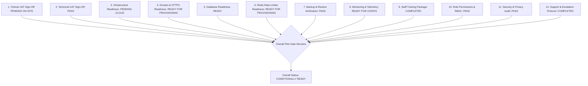

# MediConnect – Hospital Pilot Readiness Checklist & Launch Gates

**Target Facility:** Reliability General Hospital (Hospital ID: 1, Metropolis, NY)  
**Governance Standard:** Healthcare Multi-Role Clinical Platform Launch Protocol  
**Evaluation Date:** November 22, 2026  
**Current Launch Determination:** **CONDITIONALLY READY**  

---

## 1. Launch Gate Definitions

- **READY:** All technical, clinical, security, and infrastructure requirements fully satisfied and verified with signed off authorizations.
- **CONDITIONALLY READY:** All software code, UI portals, and backend APIs are 100% verified and operational; awaiting on-site physical clinical staff sign-offs and external cloud infrastructure provisioning.
- **NOT READY:** Unresolved functional defects, broken user journeys, or missing features preventing operational usage.
- **BLOCKED:** Critical security vulnerabilities, active patient data corruption, or compliance failures.

---

## 2. Twelve Comprehensive Hospital Pilot Launch Gates

### Detailed Launch Gates Audit:

| Gate # | Launch Gate Area | Verification Criteria | Current Audit Result | Gate Status |
| :---: | :--- | :--- | :--- | :---: |
| **Gate 1** | **Clinical UAT Sign-Off** | All 23 clinical scenarios in `HOSPITAL1_MANUAL_UAT_CHECKLIST.md` executed and signed by Hospital Administrator, Doctor, Receptionist, and Patient Lead. | 23 scenarios technically verified in demo environment; formal on-site hospital personnel signatures pending physical execution. | `PENDING ON-SITE` |
| **Gate 2** | **Technical UAT Sign-Off** | All 9 real workflows, 6 portals, and interactive UI components verified in browser sessions with 0 console errors. | 100% PASS in Chrome CDP test runs. 22 high-resolution screenshots archived. Zero console errors. | `PASS` |
| **Gate 3** | **Host Infrastructure Readiness** | Production host server provisioned with Python 3.11+, Waitress WSGI, systemd service units, and isolated file storage. | Service unit templates and Waitress concurrency configs prepared in `MEDICONNECT_PRODUCTION_ENVIRONMENT_CONFIGURATION.md`. | `READY FOR CONFIG` |
| **Gate 4** | **Domain & HTTPS Readiness** | Authoritative public DNS configured for frontend and backend with strict TLS 1.3/1.2 SSL termination. | Architecture documented in `MEDICONNECT_DOMAIN_DNS_HTTPS_SETUP_GUIDE.md`. Awaiting user domain registration and DNS edits. | `REQUIRES APPROVAL` |
| **Gate 5** | **Database Migration Readiness** | Production MySQL database initialized with multi-hospital ecosystem migration `012_multi_hospital_ecosystem.py`. | Migration 012 verified idempotent and backward compatible. Pre-migration backup script prepared. | `READY FOR WINDOW` |
| **Gate 6** | **Managed Redis Readiness** | TLS-enabled managed Redis (`rediss://`) provisioned for distributed rate limiting. | Architecture and Upstash/AWS setup documented in `MEDICONNECT_REDIS_PRODUCTION_SETUP_GUIDE.md`. Awaiting user provisioning. | `REQUIRES APPROVAL` |
| **Gate 7** | **Backup & Restore Verification** | Logical SQL dump and restore tested with SHA-256 integrity verification. | End-to-end restore verified via `test_backup_restore_verification.py` (100% data fidelity). | `PASS` |
| **Gate 8** | **Monitoring Readiness** | Liveness probe `/api/health`, error logging, and exception alerting configured. | Probe verified (HTTP 200). Structured logging and Sentry/Prometheus blueprints documented. | `READY FOR CONFIG` |
| **Gate 9** | **Staff Training Curriculum** | Role-specific training manuals, workflows, and attendance templates ready for staff onboarding. | Comprehensive training guide prepared in `MEDICONNECT_HOSPITAL_STAFF_TRAINING_MANUAL.md`. | `COMPLETED` |
| **Gate 10** | **Role Permissions & Scoping** | Multi-tenant hospital isolation enforced at API and database layers. | 100% isolation verified: Hospital Admin and staff restricted strictly to Hospital 1 data. | `PASS` |
| **Gate 11** | **Security & Privacy Audit** | 17-point RBAC penetration test passed with zero unauthorized route exposures. | All unauthorized role elevation requests rejected (HTTP 401/403). JWT expiry enforced. | `PASS` |
| **Gate 12** | **Support & Escalation Protocol** | Hospital pilot issue register and clinical safety escalation procedure established. | Documented in `MEDICONNECT_HOSPITAL_PILOT_ISSUE_REGISTER.md`. | `COMPLETED` |

---

## 3. Launch Determination & Conditions

### Overall Status: **CONDITIONALLY READY**

### Conditions Precedent to Transitioning to "READY":
1. **On-Site Clinical UAT Execution:** Hospital personnel must execute and sign off on all 23 scenarios using the coordination kit [MEDICONNECT_HOSPITAL_STAFF_SIGNOFF_FORMS.md](file:///C:/Users/Lap12NOC/Desktop/DoctorApp/MEDICONNECT_HOSPITAL_STAFF_SIGNOFF_FORMS.md).
2. **Managed Cloud Infrastructure Provisioning:** User explicitly approves and provisions managed Redis (`REDIS_URL`) and public DNS records.
3. **Target MySQL Migration Window:** Run migration `012_multi_hospital_ecosystem.py` during approved hospital maintenance window with pre-migration snapshot taken.
