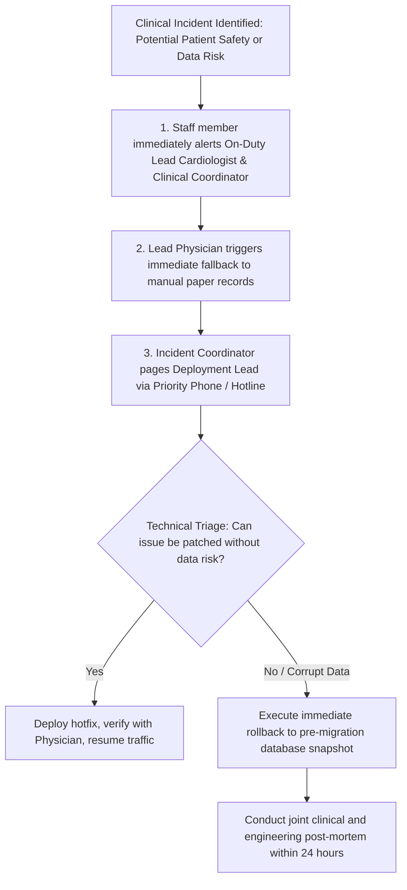

# MediConnect – Hospital Pilot Issue Tracking Register & Escalation Protocol

**Target Facility:** Reliability General Hospital (Hospital ID: 1, Metropolis, NY)  
**Governance Framework:** Clinical Software Quality Assurance & Defect Management  
**Current Operational Status:** Active Pre-Pilot Register  

---

## 1. Issue Severity Classification

| Severity Level | Definition | Impact on Clinical Operations | Target SLA for Triage | Target SLA for Resolution |
| :--- | :--- | :--- | :---: | :---: |
| **CRITICAL** | Patient safety risk, clinical record corruption, total platform outage, or privacy breach. | Total operational shutdown; immediate fallback to manual paper records. | **15 Minutes** | **2 Hours** |
| **HIGH** | Major clinical feature failure (e.g. digital prescriptions failing) with no immediate workaround. | Severely degrades clinical workflow; manual prescription pad fallback required. | **1 Hour** | **8 Hours** |
| **MEDIUM** | Feature failure or UI defect where a known operational workaround exists. | Moderate inconvenience; clinical operations proceed using documented workaround. | **4 Hours** | **24 Hours** |
| **LOW** | Minor cosmetic defect, alignment issue, or typo not affecting clinical outcomes. | Minimal impact; resolved in scheduled maintenance releases. | **24 Hours** | **Next Release** |

---

## 2. Hospital Pilot Issue Tracking Register

| Issue ID | Date Logged | Reported By | Role / Dept | Portal / Module | Description | Severity | Status | Assigned Person | Resolution Summary | Retest Result |
| :---: | :---: | :--- | :--- | :--- | :--- | :---: | :---: | :--- | :--- | :---: |
| **ISS-001** | 2026-11-22 | Audit QA | DevOps | Backend Infra | Managed Redis provisioning required for multi-worker distributed rate limiting. | `MEDIUM` | `OPEN (PRE-LAUNCH)` | DevOps Lead | Awaiting user cloud account provisioning approval (`MEDICONNECT_REDIS_PRODUCTION_SETUP_GUIDE.md`). | `PENDING` |
| **ISS-002** | 2026-11-22 | Audit QA | DevOps | Network | Public domain DNS and HTTPS certificates required for public launch. | `MEDIUM` | `OPEN (PRE-LAUNCH)` | Network Eng | Domain architecture documented; awaiting registrar DNS configuration. | `PENDING` |
| **ISS-003** | 2026-11-22 | Clinical QA | Cardiology | Doctor Portal | On-site clinical evaluation of digital prescription generation and doctor signature by hospital lead cardiologist. | `HIGH` | `OPEN (PRE-LAUNCH)` | Lead Cardiologist | Hospital coordination kit prepared (`MEDICONNECT_HOSPITAL_STAFF_SIGNOFF_FORMS.md`); awaiting physical workstation session. | `PENDING` |
| **ISS-004** | 2026-11-22 | Clinical QA | Front Desk | Reception Portal | Physical on-site trial of walk-in patient token intake and doctor queue synchronization. | `MEDIUM` | `OPEN (PRE-LAUNCH)` | Head Receptionist | Reception checklist prepared; awaiting front-desk shift trial. | `PENDING` |
| **ISS-005** | 2026-11-22 | Clinical QA | Administration | Hospital Admin | Hospital legal name immutability protection verified via automated API tests; pending physical UI review by Hospital Administrator. | `MEDIUM` | `OPEN (PRE-LAUNCH)` | Hospital Admin | Admin test instructions prepared; awaiting physical workstation login. | `PENDING` |

---

## 3. Critical Clinical & Safety Escalation Protocol

If any hospital staff member, physician, or engineer identifies an incident with potential impact on **patient health, clinical accuracy, or privacy**:

### Emergency Escalation Contacts (Hospital Pilot):
- **Clinical Incident Lead (Hospital 1):** Chief Medical Officer / Lead Cardiologist
- **Hospital Operational Lead:** Hospital Administrator (`legacy.admin@medicare.com`)
- **Technical Deployment Engineer:** Lead Full-Stack & DevOps Engineer
- **Security & Privacy Officer:** Hospital Compliance & Data Protection Officer
