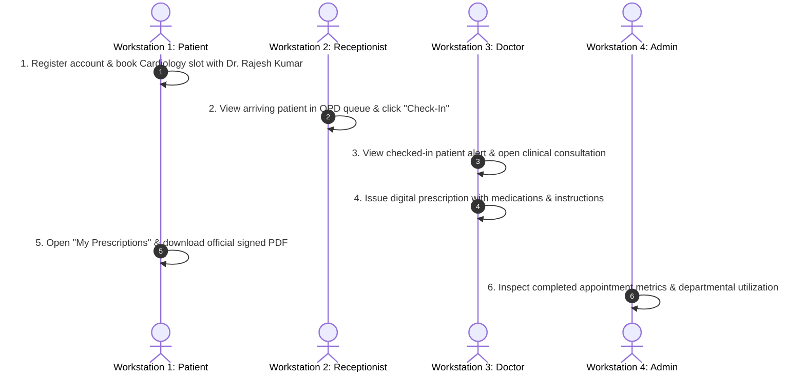

# MediConnect – Hospital Staff Clinical UAT Coordination & Sign-Off Package

**Target Facility:** Reliability General Hospital (Hospital ID: `1`, Metropolis, NY)  
**Package Classification:** On-Site Clinical User Acceptance Testing Kit  
**Target Audience:** Hospital Administrator, Lead Doctor (Cardiology), Head Receptionist, Patient Experience Lead  
**Effective Date:** Hospital Pilot Phase 1  

---

## 1. Clinical UAT Instructions for Hospital Staff

This coordination kit contains step-by-step role-specific instructions for clinical and administrative staff members evaluating the MediConnect platform prior to admitting live patient traffic.

### A. Hospital Administrator Instructions
1. **Accessing the Portal:** Open Google Chrome and navigate to `http://<hospital-pilot-domain>/login`. Select the **Hospital Admin** tab and log in using your assigned administrator credentials (`legacy.admin@medicare.com`).
2. **Reviewing Hospital Profile:** Navigate to **Hospital Profile** (`/hospital-admin/hospital-profile`). Confirm that the hospital's registered legal name is locked against accidental tampering. Update contact phone numbers and facility descriptions if needed and verify saving.
3. **Staff Roster Review:** Open **Doctors** and **Receptionists** menus. Confirm that only healthcare professionals assigned to Reliability General Hospital are listed.
4. **Scoping Verification:** Review the **Appointments** table to ensure no appointments from other facilities are visible.
5. **Sign-off:** Record notes in Section 3 of this document and complete Form HA-SIGNOFF.

### B. Lead Cardiologist / Attending Doctor Instructions
1. **Accessing the Portal:** Navigate to `/login`. Select the **Doctor** tab and log in as Dr. Rajesh Kumar (`dr.one@medicare.com`).
2. **Daily Queue Review:** Open `/doctor/appointments`. Review your scheduled consultations, patient age, gender, and consultation reasons.
3. **Clinical Consultation & Digital Rx:** Select a patient from your queue. Click **Issue Rx** to launch the digital prescription builder. Enter diagnosis, prescribed medications, dosage (e.g. 500mg), frequency (e.g. 1-0-1), and clinical instructions. Confirm that the generated prescription accurately records your digital timestamp, credentials, and NMC registration number.
4. **Availability Hours:** Navigate to **Profile** and verify your clinical consulting hours.
5. **Sign-off:** Record clinical feedback and complete Form DOC-SIGNOFF.

### C. Head Receptionist Instructions
1. **Accessing the Portal:** Navigate to `/login`. Select the **Receptionist** tab and log in using `reception.hosp1@medicare.com`.
2. **OPD Queue Review:** View today's scheduled arrivals on `/admin`.
3. **Walk-in Patient Intake:** Navigate to `/admin/checkin`. Register a test walk-in patient by entering name, phone number, age, and gender. Confirm that an OPD token is generated.
4. **Arrival Check-In:** Locate a scheduled patient arriving for consultation and click **Check-In**. Verify that the status transitions to `Checked-In` and alerts the doctor.
5. **Sign-off:** Record front-desk observations and complete Form REC-SIGNOFF.

### D. Patient Experience Lead Instructions
1. **Self-Service Registration:** Navigate to `/register`. Register a patient account and confirm that the registration confirmation directs to login.
2. **Doctor Discovery & Booking:** Search for Cardiology specialists, select an open consultation slot, and submit booking.
3. **Digital Prescription & PDF Download:** Navigate to `/patient/prescriptions`. View the prescription issued by the doctor and click **PDF** to verify that the official hospital letterhead and medications download cleanly.
4. **Emergency Hotline:** Verify that clicking **Ambulance 108** on the navbar opens the emergency dispatch center with direct `tel:108` calling triggers.
5. **Sign-off:** Complete Form PAT-SIGNOFF.

---

## 2. Clinical Workflow Demonstration Guide

To conduct a live demonstration for hospital leadership and department heads, execute the following 5-step synchronized flow across four test workstations or browser tabs:



---

## 3. Official Staff Sign-Off Forms

All four stakeholder roles must independently evaluate their respective modules and record their official acceptance verdict before pilot launch.

---

### Form HA-SIGNOFF: Hospital Administrator Acceptance Form

- **Hospital Name:** Reliability General Hospital (Hospital ID: 1)
- **Tester Name:** __________________________________________________
- **Official Designation:** __________________________________________
- **Date of Testing:** ________________________ **Contact Phone:** ________________________

**Test Evaluation Checklist:**
- `[ ]` Hospital registered legal name is immutable.
- `[ ]` Doctors and reception staff roster verified.
- `[ ]` Cross-hospital data isolation confirmed.
- `[ ]` Administrative reports and operational cards verified.

**Defects / Clinical Notes Observed:**
____________________________________________________________________________________________________
____________________________________________________________________________________________________

**Acceptance Decision:**
- `[ ] ACCEPTED FOR PILOT LAUNCH`
- `[ ] CONDITIONALLY ACCEPTED (Minor non-clinical defects documented)`
- `[ ] REJECTED (Defects requiring immediate remediation)`

**Signature:** __________________________________________________ **Date:** ___________________

---

### Form DOC-SIGNOFF: Lead Doctor / Clinical Acceptance Form

- **Hospital Department:** Department of Cardiology
- **Doctor Name:** __________________________________________________
- **Medical Council Reg. No.:** ______________________________________
- **Date of Testing:** ________________________ **Contact Email:** ________________________

**Test Evaluation Checklist:**
- `[ ]` Daily appointment queue displays correct patient information.
- `[ ]` Digital prescription modal captures diagnosis, medications, dosage, frequency, and instructions.
- `[ ]` Doctor credentials and NMC registration are accurately affixed to prescriptions.
- `[ ]` Patient medical history is accessible only to attending physicians.

**Defects / Clinical Notes Observed:**
____________________________________________________________________________________________________
____________________________________________________________________________________________________

**Acceptance Decision:**
- `[ ] ACCEPTED FOR PILOT LAUNCH`
- `[ ] CONDITIONALLY ACCEPTED (Minor non-clinical defects documented)`
- `[ ] REJECTED (Defects requiring immediate remediation)`

**Signature:** __________________________________________________ **Date:** ___________________

---

### Form REC-SIGNOFF: Front-Desk Receptionist Acceptance Form

- **Hospital Department:** Front Office & Outpatient Intake
- **Staff Name:** __________________________________________________
- **Designation:** _________________________________________________
- **Date of Testing:** ________________________ **Shift / Station:** _______________________

**Test Evaluation Checklist:**
- `[ ]` OPD queue lists scheduled arrivals dynamically.
- `[ ]` Walk-in patient intake form generates patient tokens without delays.
- `[ ]` Patient check-in action synchronizes arrival status with the doctor.
- `[ ]` Booking is restricted to assigned hospital doctors only.

**Defects / Clinical Notes Observed:**
____________________________________________________________________________________________________
____________________________________________________________________________________________________

**Acceptance Decision:**
- `[ ] ACCEPTED FOR PILOT LAUNCH`
- `[ ] CONDITIONALLY ACCEPTED (Minor non-clinical defects documented)`
- `[ ] REJECTED (Defects requiring immediate remediation)`

**Signature:** __________________________________________________ **Date:** ___________________

---

### Form PAT-SIGNOFF: Patient Experience & Quality Lead Acceptance Form

- **Evaluator Name:** __________________________________________________
- **Designation:** _____________________________________________________
- **Date of Testing:** ________________________ **Channel:** Web / Mobile Browser

**Test Evaluation Checklist:**
- `[ ]` Patient self-service registration and login work smoothly.
- `[ ]` Doctor search, specialty discovery, and slot booking are intuitive.
- `[ ]` Prescriptions and downloadable PDFs render cleanly.
- `[ ]` Ambulance 108 emergency beacon and phone action are verified.
- `[ ]` Telugu and English language switching works across all pages.

**Defects / Clinical Notes Observed:**
____________________________________________________________________________________________________
____________________________________________________________________________________________________

**Acceptance Decision:**
- `[ ] ACCEPTED FOR PILOT LAUNCH`
- `[ ] CONDITIONALLY ACCEPTED (Minor non-clinical defects documented)`
- `[ ] REJECTED (Defects requiring immediate remediation)`

**Signature:** __________________________________________________ **Date:** ___________________

---

## 4. Defect Reporting & Triage Format

When hospital personnel identify an issue during on-site testing, record the defect using this standard format:

```markdown
### Hospital UAT Defect Ticket: [DEF-YYYYMMDD-XX]
- **Date & Time:** [YYYY-MM-DD HH:MM]
- **Reported By:** [Name & Role]
- **Portal / Screen:** [Hospital Admin / Doctor / Reception / Patient]
- **Severity Level:**
  - [ ] CRITICAL (Patient safety risk, data corruption, total workflow blocker)
  - [ ] HIGH (Feature failure with no operational workaround)
  - [ ] MEDIUM (Feature failure with existing clinical workaround)
  - [ ] LOW (Cosmetic, text typo, styling alignment)
- **Step-by-Step Reproduction:**
  1. ...
  2. ...
- **Observed Behavior:** [What actually occurred]
- **Expected Clinical Behavior:** [What should have occurred]
- **Screenshot / Error Message:** [Attach photo or record error string]
```

---

## 5. Hospital Pilot UAT Completion Criteria

The hospital pilot may be green-lit for live traffic **ONLY** when all of the following exit criteria are met:
1. **Four Authorized Sign-Offs Obtained:** All four forms (`HA-SIGNOFF`, `DOC-SIGNOFF`, `REC-SIGNOFF`, `PAT-SIGNOFF`) signed and dated.
2. **Zero Critical or High Severity Defects:** All identified Critical or High defects remediated and retested.
3. **Data Protection Certification:** Strict multi-tenant patient privacy verified on clinical workstations.
4. **On-Site Operational Acceptance:** Hospital Administrator and Chief Medical Officer issue joint sign-off.
