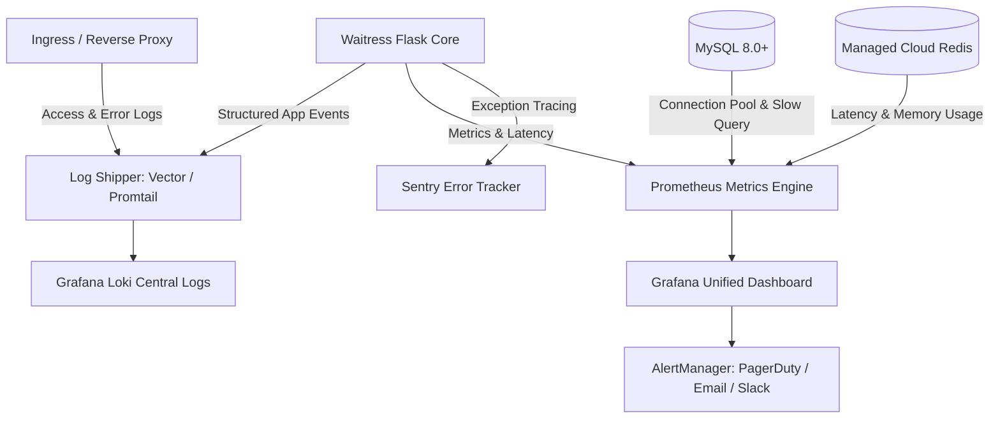

# MediConnect – Production Monitoring, Logging & Security Architecture

**Domain:** Operational Observability, System Health, Security Auditing & Compliance  
**Compliance Standards:** HIPAA Security Rule / DISHA / ISO 27001  
**Target Environment:** Production Infrastructure  
**Document Status:** Operational Blueprint & Telemetry Specification  

---

## 1. Production Monitoring Architecture

To ensure 99.9% uptime for hospital clinical workflows, a multi-tiered monitoring stack continuously inspects application health, database throughput, cache availability, and user anomalies.



### Telemetry & Health Probe Matrix:
| Target Component | Metric / Health Probe | Normal Threshold | Critical Alert Trigger | Remediation Action |
| :--- | :--- | :---: | :---: | :--- |
| **Frontend Web App** | Synthetic Uptime Ping | HTTP 200 within 1.5s | HTTP != 200 or timeout > 5s | Ingress failover, CDN purge |
| **Backend API Core** | `GET /api/health` | HTTP 200 within 200ms | 3 consecutive failures | Restart Waitress systemd daemon |
| **Database Connection** | Active Connections & Query Latency | < 70% pool, < 50ms query | Pool exhausted (> 90%) or query > 2s | Recycle stale connections, slow log audit |
| **Managed Redis Cache** | Ping Response & Memory Usage | < 10ms ping, < 80% RAM | Connection timeout or eviction spike | Scale cache tier, verify network route |
| **Application Exceptions** | Uncaught 500 Server Errors | 0 errors per minute | > 3 errors in 5 minutes | Sentry issue triage, rollback if bug |
| **Security Anomalies** | 401/403 Failure Bursts | < 5 per minute per IP | > 20 per minute per IP | Trigger Redis IP rate-limit ban (429) |
| **Host System Storage** | Disk Free Space (`/var/backups`) | > 25% free storage | < 15% free storage | Purge archives older than retention window |

---

## 2. Privacy-Hardened Logging Policy (Zero PII in Logs)

In accordance with patient health information (PHI) data protection standards:

### Strict Sanitization Directives:
1. **Never Log Sensitive Credentials:** Passwords, password hashes, JWT authorization tokens, and encryption keys must never appear in log streams.
2. **Never Log Clinical PII:** Patient medical diagnoses, medication names, symptoms, phone numbers, and National ID numbers must not be emitted to standard output or log files.
3. **Structured Request Logging:** Log entries record operational context only:
   ```json
   {
     "timestamp": "2026-11-22T10:35:00.123Z",
     "level": "INFO",
     "method": "POST",
     "path": "/api/prescriptions",
     "status": 201,
     "duration_ms": 42.5,
     "user_id": 14,
     "role": "DOCTOR",
     "hospital_id": 1,
     "client_ip": "10.0.4.15"
   }
   ```

---

## 3. Security & Access Control Enforcement

### A. Role-Based Access Control (RBAC)
- All incoming requests to protected routes pass through `jwt_required` and role decorators (`role_required('DOCTOR')`, `role_required('ADMIN')`).
- Role elevation attempts (e.g. Patient accessing `/api/owner/overview`) are rejected with HTTP 403 Forbidden.

### B. Multi-Tenant Cross-Hospital Data Isolation
- Queries are strictly scoped by `hospital_id`.
- Hospital Admin accounts, doctors, and receptionists cannot view, query, or mutate records outside their registered facility.

### C. Session & Token Expiration
- Access tokens expire after 72 hours (`JWT_EXPIRATION_HOURS=72`).
- Navigating to logout in the UI triggers immediate client-side token destruction and invalidation.

### D. Audit Trail Recording
- Critical administrative operations (superadmin assignments, hospital profile updates, primary admin replacements, doctor suspensions) are automatically written to the `audit_logs` database table with timestamp, operator ID, target resource, and action description.
