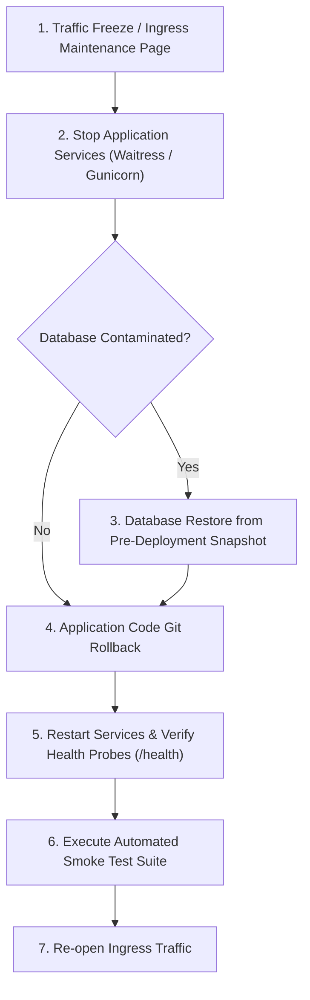

# MediConnect – Production Rollback & Disaster Recovery Standard Operating Procedure (SOP)

**Document Classification:** Emergency Operations Procedure  
**Target Environment:** MediConnect Production (`mediconnect` on MySQL 8.0)  
**Scope:** Hospital 1 Pilot & Multi-Hospital Ecosystem  

---

## 1. Incident Severity Classification & Rollback Triggers

Initiate immediate rollback under any of the following critical conditions:

| Incident Level | Operational Condition | Action Required | Authorized By |
| :--- | :--- | :--- | :--- |
| **SEV-1 (Critical)** | Data corruption, active database deadlock storm, unhandled HTTP 500 error rate > 5%, or security breach. | **Immediate Full Rollback** (Code + Database) | Lead Architect / Platform Owner |
| **SEV-2 (Major)** | Authentication/JWT failure across portals, appointment slot collision bug, or email invitation failure. | **Application Rollback** (Code only) | Senior DevOps Engineer / QA Lead |
| **SEV-3 (Minor)** | UI cosmetic regression, non-critical translation mismatch, or minor styling glitch. | **Patch Forward** (No rollback required) | Frontend Engineer |

---

## 2. Emergency Rollback Playbook (Step-by-Step)



### Step 1: Immediate Ingress Traffic Freeze
If behind Nginx or Cloudflare, route users to a branded maintenance notice to prevent in-flight state mutations:
```bash
# Nginx Maintenance Mode toggle
ln -sf /etc/nginx/conf.d/maintenance.conf /etc/nginx/sites-enabled/
nginx -s reload
```

### Step 2: Stop Active Backend Services
```powershell
# Windows Server
Stop-Process -Name python -Force -ErrorAction SilentlyContinue

# Linux Server (systemd)
systemctl stop mediconnect-backend
```

### Step 3: Database Rollback (If Contaminated)
1. **Identify the verified pre-deployment snapshot:**
   ```powershell
   python backend/backup_mysql.py list
   ```
2. **Execute non-interactive database restoration:**
   ```powershell
   python backend/backup_mysql.py restore --file=backend/backups/mysql/mediconnect_mysql_20261121_100923_remediation_phase1.json --yes
   ```
3. **Verify record parity across all 16 tables:**
   The tool automatically compares all 16 tables and asserts 100% parity before exiting. Verify output displays:
   `[SUCCESS] Restoration completed flawlessly! Total records active: 218`.

### Step 4: Application Code Rollback
Check out the last known stable Git commit:
```powershell
# Verify commit history
git log --oneline -n 5

# Revert to stable deployment release tag or commit
git checkout <STABLE_COMMIT_HASH>
```

### Step 5: Service Restart
```powershell
# Windows Server (Waitress)
waitress-serve --listen=127.0.0.1:5000 --threads=8 wsgi:app

# Linux Server (Gunicorn)
systemctl start mediconnect-backend
```

### Step 6: Post-Rollback Validation Probes
Run post-rollback verification before restoring user traffic:

```powershell
# 1. API Health Check
curl -i http://127.0.0.1:5000/health
# Expected: 200 OK {"status": "ok", "success": true}

# 2. Database Read Probe
curl -i http://127.0.0.1:5000/api/hospitals/1
# Expected: 200 OK (Reliability General Hospital)

# 3. RBAC Boundary Probe
curl -i http://127.0.0.1:5000/api/hospital-admin/dashboard
# Expected: 401 Unauthorized
```

### Step 7: Re-open Ingress Traffic
Remove the maintenance notice and resume normal production routing:
```bash
rm -f /etc/nginx/sites-enabled/maintenance.conf
nginx -s reload
```

---

## 3. Post-Incident Review & Root Cause Analysis (RCA)

Following rollback stabilization:
1. Export application error logs and audit records:
   ```powershell
   python -c "import sys; sys.path.insert(0, 'backend'); from models import db, AuditLog; from app import create_app; app = create_app();
   with app.app_context():
       logs = AuditLog.query.order_by(AuditLog.id.desc()).limit(50).all()
       [print(f'{l.timestamp} [{l.action}] user={l.user_id} details={l.details}') for l in logs]
   " > post_mortem_audit_trail.txt
   ```
2. Convene technical post-mortem meeting within 24 hours.
3. Archive the post-mortem report and document preventative test cases in `backend/test_ecosystem_redesign.py`.
