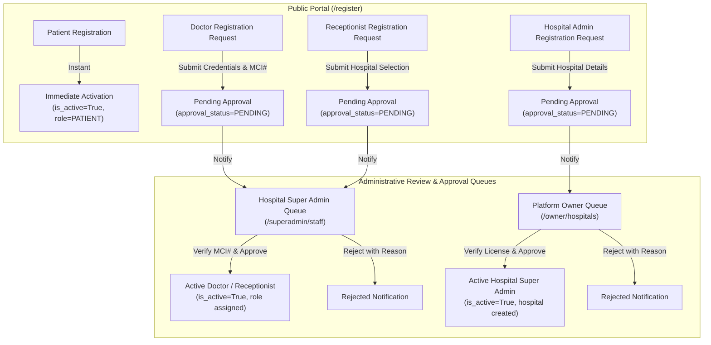

# MEDICONNECT — COMPLETE PROJECT ASSESSMENT REPORT
**Phase 1: Comprehensive System Audit & Role-Based Workflow Plan**  
*Document Version: 1.0 | Date: November 10, 2026 | Mode: Read-Only System Assessment*

---

## Executive Summary

A comprehensive, non-destructive, read-only audit of the **MediConnect Multi-Hospital Healthcare Management System** was conducted at `C:\Users\Lap12NOC\Desktop\DoctorApp`. 

The system is a production-capable, multi-tenant healthcare web platform powered by a **React 19 / Vite** single-page frontend, a **Flask / SQLAlchemy / Waitress** WSGI backend, and a **MySQL 8.0** relational database (`mediconnect`).

All core services, security controls, multi-tenant hospital scoping, and 362 test suite cases were inspected. The application builds cleanly (Vite: 0 errors in 3.05s) and passes all code quality checks (Oxlint: 0 errors).

This report outlines the existing architecture, assesses the five user portals, evaluates current registration capabilities, recommends an enterprise account approval workflow, details an Indian doctor profile enhancement plan, summarizes security findings, and proposes a safe, backward-compatible implementation roadmap.

---

## 1. Project Architecture

### 1.1 Technology Stack & Versions
- **Frontend Framework**: React 19.2.8 with Vite 8.2.2 dev/build server.
- **Routing**: React Router DOM 7.18.3 with lazy-loaded route splitting and role-based guards.
- **Styling & UI**: Custom CSS Design System with CSS variables (`var(--primary)`, `var(--slate-*)`), responsive grid layouts, and `react-icons` (FontAwesome 5).
- **Notifications**: `react-toastify` 11.1.0.
- **Backend Framework**: Python 3.11.9 with Flask 3.1.3 WSGI application.
- **Production Server**: Waitress 3.0.0 multi-threaded WSGI server (`--threads=4`, host `127.0.0.1:5000`).
- **ORM & Database Driver**: SQLAlchemy 2.0.52 with PyMySQL 1.2.0 driver.
- **Token & Auth**: PyJWT 2.13.0 with HS256 HMAC-SHA256 signatures; Cryptography 42.0.7; Werkzeug 3.1.3 password hashing (`pbkdf2:sha256:600000`).
- **CORS & Proxying**: `flask-cors` with strict origin whitelist regex; Werkzeug `ProxyFix` for reverse proxy headers (`X-Forwarded-For`).
- **Rate Limiting**: Custom atomic sliding-window rate limiter with Redis Lua script support and thread-safe SQLite fallback.

### 1.2 Directory Structure
```
DoctorApp/
├── backend/
│   ├── app.py                     # Flask app factory, blueprint registration, CORS, error handling
│   ├── config.py                  # Environment config, MySQL/SQLite URI resolution, engine pooling
│   ├── database.sql               # Base database schema definitions
│   ├── doctor_hospital.db         # Original master SQLite database (253,952 bytes)
│   ├── manage.py                  # CLI management (owner promotion, migration runner)
│   ├── models.py                  # 11 SQLAlchemy models with constraints and relationships
│   ├── requirements.txt           # Python package dependencies
│   ├── seed.py                    # Comprehensive database seeder
│   ├── check_demo_prerequisites.py# Pre-flight diagnostic check utility
│   ├── stop_demo.py               # Safe process termination utility
│   ├── migrations/                # 8 ordered, tracked migrations (001 to 008)
│   ├── routes/                    # 12 modular Flask blueprints
│   └── utils/                     # auth_middleware, rate_limiter, audit, db_sequences
├── frontend/
│   ├── index.html                 # Single page application entry point
│   ├── package.json               # Node.js dependencies and build scripts
│   ├── vite.config.js             # Vite build config with /api reverse proxy
│   └── src/
│       ├── App.jsx                # Main route tree with RoleRoute and ProtectedRoute
│       ├── context/               # AuthContext (session state, role mismatch handling)
│       ├── components/            # Reusable UI components (Navbar, Footer, DoctorCard, etc.)
│       ├── pages/                 # Public & portal pages (owner, superadmin, admin, doctor, patient)
│       ├── services/              # Axios API service clients
│       └── utils/                 # roleUtils, toast, specialtyMap
└── docs/                          # Screenshots, test reports, and pre-deployment guides
```

### 1.3 Database Architecture & Storage
- **Primary Database**: MySQL 8.0.46 database `mediconnect` on `localhost:3306`.
  - Character Set: `utf8mb4` with `utf8mb4_unicode_ci` collation.
  - Connection Pool: `pool_pre_ping=True`, `pool_recycle=300`, `pool_size=10`, `max_overflow=20`.
  - Active Tables (13): `users`, `hospitals`, `specializations`, `doctors`, `appointments`, `ambulances`, `ambulance_requests`, `reviews`, `favorites`, `invitations`, `audit_logs`, `schema_migrations`, `migration_managed_objects`.
  - Active Records: 31 users, 6 doctors, 4 hospitals, 1 specialization, 5 appointments, 7 ambulance requests, 4 invitations, 9 audit logs.
- **Master SQLite Database**: `backend/doctor_hospital.db` (253,952 bytes, 14 tables) preserved intact. Used as a reference fallback and template for isolated automated test runs.
- **Migration Tracking**: `schema_migrations` table tracks versions 001 through 008; all migrations are currently applied.

### 1.4 Git Status & Working Tree
- **Active Branch**: `main`
- **Remote**: `origin` (`https://github.com/CHAITHANYA323/MY_DOCTOR_APP.git`)
- **Current Commit**: `0a19289` ("docs: update Phase 5 final review report with verified commit hash and push details")
- **Working Tree**: Completely clean; zero unstaged code changes. (Only `PRE_DEPLOYMENT_MANUAL_REVIEW_GUIDE.md` exists as an untracked local document).

---

## 2. Five User Portals Assessment

```
┌────────────────────────────────────────────────────────────────────────┐
│                        MEDICONNECT PORTALS                             │
├─────────────────┬──────────────────┬─────────────────┬─────────────────┤
│ 1. Platform     │ 2. Hospital      │ 3. Receptionist │ 4. Doctor       │
│    Owner        │    Super Admin   │    Terminal     │    Clinical     │
│    (/owner)     │    (/superadmin) │    (/admin)     │    (/doctor)    │
├─────────────────┴──────────────────┴─────────────────┴─────────────────┤
│ 5. Patient / User Healthcare Portal (/patient)                        │
└────────────────────────────────────────────────────────────────────────┘
```

### 2.1 Portal 1: Platform Owner
- **Role Identifier**: `PLATFORM_OWNER`
- **Theme & Branding**: Deep Slate / Crimson Red (`#b91c1c`, `linear-gradient(135deg, #b91c1c, #991b1b)`).
- **Default Route**: `/owner`
- **Authentication**: Sign in via `/login` under "Platform Owner" tab. Strict role verification prevents non-owner accounts from signing in here.
- **Registration**: Strictly forbidden via public UI. Accounts are provisioned via CLI (`python backend/manage.py promote-owner --email=...`) or direct server management.
- **Dashboard Features**:
  - Global metrics across all tenant hospitals (total hospitals, active doctors, registered patients, pending invitations, ambulances, appointments).
  - Hospital oversight table showing assigned Hospital Super Admins, city, state, and operational status.
  - Invitation status tracker (Pending, Accepted, Expired, Revoked).
- **Available Actions**:
  - Register new tenant hospital with an invited initial Hospital Super Admin (`POST /api/platform/hospitals`).
  - Invite additional Hospital Super Admins (`POST /api/platform/invitations`).
  - Revoke or resend pending invitations.
  - Review immutable platform-wide audit logs with IP tracking and sanitized parameter display (`/owner/audit-logs`).
- **Role-Based Permissions**: Global administrative authority. No `hospital_id` constraint. Zero cross-tenant data leakage.
- **Missing Functionality & Limitations**:
  - No inbound registration request queue: currently, Platform Owner can only initiate outbound invitations; there is no queue to approve Super Admins who request registration.
  - No hospital suspension / deactivation toggle in the UI.
- **Known Bugs**: None detected.

---

### 2.2 Portal 2: Hospital Super Admin
- **Role Identifier**: `HOSPITAL_SUPER_ADMIN`
- **Theme & Branding**: Operations Amber / Bronze (`#ea580c`, `linear-gradient(135deg, #ea580c, #c2410c)`).
- **Default Route**: `/superadmin`
- **Authentication**: Sign in via `/login` under "Super Admin" tab. Requires active account assigned to a valid `hospital_id`.
- **Registration**: No public registration. Account is created when the user accepts an invitation token issued by the Platform Owner (`/invite/accept/:token`).
- **Dashboard Features**:
  - Hospital-specific operational metrics (on-duty doctors, receptionists, today's appointments, emergency ambulances).
  - Quick action shortcuts for inviting staff, reviewing roster, and updating department settings.
- **Available Actions**:
  - Staff Management (`/superadmin/staff`): Active staff roster, issue Doctor or Receptionist invitations, link invitations to doctor clinical profiles, revoke/resend invitations.
  - Doctor Directory (`/superadmin/doctors`): Hospital-scoped doctors list and availability.
  - Departments & Specializations (`/superadmin/departments`): Hospital departmental allocation.
  - Appointment Oversight (`/superadmin/appointments`): Filter appointments across all hospital doctors.
  - Ambulance Fleet (`/superadmin/ambulances`): Hospital-owned emergency vehicle management.
  - Operational Reports (`/superadmin/reports`): Appointment completion rates, emergency response times.
  - Hospital Settings (`/superadmin/settings`): Emergency hotline, contact phone, operating hours, facility tags.
- **Role-Based Permissions**: Strictly scoped to caller's `hospital_id`. Queries enforce `WHERE hospital_id = :hosp_id`. Legacy unassigned `ADMIN` accounts are rejected with 403.
- **Missing Functionality & Limitations**:
  - Lacks an inbound self-registration approval queue for prospective Doctors and Receptionists.
  - Cannot directly upload staff profile photos; currently accepts image URLs.
- **Known Bugs**: None detected.

---

### 2.3 Portal 3: Hospital Admin / Receptionist
- **Role Identifier**: `RECEPTIONIST`
- **Theme & Branding**: Modern Front-Desk Violet (`#7c3aed`, `linear-gradient(135deg, #7c3aed, #6d28d9)`).
- **Default Route**: `/admin`
- **Authentication**: Sign in via `/login` under "Reception / Admin" tab.
- **Registration**: No public registration. Provisioned by Hospital Super Admin via staff invitation.
- **Dashboard Features**:
  - Real-time intake queue: today's checked-in patients, pending consultations, on-duty doctors, available ambulances.
- **Available Actions**:
  - Patient Intake & Registration (`/admin/register-patient`): Rapid walk-in patient creation with automatic 24-hour temporary password generation.
  - Fast Check-In Terminal (`/admin/check-in`): 1-click arrival check-in for scheduled patients; converts appointment to `Confirmed` status and notifies doctor.
  - Appointment Booking & Scheduling (`/admin/appointments`): Search patients, select specialty doctor, assign date/time slot, book consultation.
  - Patient Directory (`/admin/patients`): Patient record search by name, phone, or email.
- **Role-Based Permissions**: Scoped strictly to assigned `hospital_id`. Cannot access platform governance or super admin settings.
- **Missing Functionality & Limitations**:
  - Cannot request account registration independently; completely reliant on Super Admin invitation.
  - Cannot reassign an appointment to a different doctor directly from the check-in queue without booking a new appointment.
- **Known Bugs**: None detected.

---

### 2.4 Portal 4: Doctor
- **Role Identifier**: `DOCTOR`
- **Theme & Branding**: Clinical Emerald Teal (`#0d9488`, `linear-gradient(135deg, #0d9488, #0f766e)`).
- **Default Route**: `/doctor`
- **Authentication**: Sign in via `/login` under "Doctor" tab. User account must be linked to a valid record in `doctors` table (`user.doctor_profile.id`).
- **Registration**: No public registration. Doctor accepts Super Admin invitation, which automatically creates the user account and links it to the pre-created `Doctor` record.
- **Dashboard Features**:
  - Daily consultation schedule: Today's agenda, pending patients, completed visits, average clinical rating.
- **Available Actions**:
  - Clinical Consultation Queue (`/doctor/appointments`): View appointment details, open consultation modal.
  - Clinical Encounter Completion: Enter clinical diagnosis notes, prescription instructions (`Rx:`), mark visit as `Completed`.
  - Patient Consultation History (`/doctor/patients`): Access previous visits and medical history for patients who have consulted with this doctor (IDOR defense strictly blocks access to unrelated patients).
  - Availability & Schedule (`/doctor/schedule`): View working days, hours, and booked time slots.
  - Clinical Profile Management (`/doctor/profile`): Update contact phone, email, spoken languages, and professional bio.
- **Role-Based Permissions**: Strictly scoped to appointments and patients where `doctor_id == current_user.doctor_profile.id`. Blocked from reception and administrative endpoints.
- **Missing Functionality & Limitations**:
  - Doctor self-registration request workflow does not exist.
  - Profile image cannot be uploaded as a file; accepts URL string.
  - Medical Council Registration Number (NMC/MCI) is not captured in the profile or schema.
- **Known Bugs**: Doctor records currently in the active database use dummy test names ("Alice Heart", "Bob Pulse", etc.).

---

### 2.5 Portal 5: Patient
- **Role Identifier**: `PATIENT` (with backward-compatible support for legacy `USER` role)
- **Theme & Branding**: Sky Blue (`#0284c7`, `linear-gradient(135deg, #0284c7, #0369a1)`).
- **Default Route**: `/patient`
- **Authentication**: Sign in via `/login` under "Patient / User" tab.
- **Registration**: Public registration is fully enabled at `/register` ("Create Patient Account").
- **Dashboard Features**:
  - Health summary: upcoming appointment count, completed consultations, emergency requests, quick booking shortcuts.
- **Available Actions**:
  - Doctor Discovery (`/patient/doctors`, `/doctors`): Filter doctors by specialty, hospital, city, fee, rating.
  - Hospital Directory (`/patient/hospitals`, `/hospitals`): Search hospitals by city, facilities, emergency capability.
  - Appointment Booking (`/appointments/book/:doctorId`): 7-day slot picker, real-time slot conflict prevention.
  - Appointment Management (`/patient/appointments`): View upcoming and past visits; cancel pending/confirmed appointments.
  - Medical Records & Prescriptions (`/patient/records`): View completed visit summaries, doctor diagnosis notes, and prescription instructions (`has_prescription` tag).
  - Emergency SOS (`/ambulance`, `/emergency`): Request urgent ambulance dispatch with GPS pickup location and idempotency protection.
  - Profile Management (`/patient/profile`): Update name, phone, avatar, and password.
- **Role-Based Permissions**: IDOR protected. Queries strictly enforce `user_id == current_user.id`. Patients cannot cancel completed visits or alter doctor clinical notes.
- **Missing Functionality & Limitations**:
  - Medical records are synthesized from completed `Appointment` notes rather than a dedicated multi-file clinical record table with lab report PDF uploads.
  - Email verification is not required after public registration (account is immediately active).
- **Known Bugs**: None detected.

---

## 3. Registration and Approval Workflow Assessment

### 3.1 Current State Analysis
Currently, MediConnect operates on a split onboarding model:
1. **Public Self-Service**: Only available for Patients (`/register`), which creates `role='USER'` with `is_active=True`.
2. **Outbound Token Invitations**: Platform Owner invites Super Admins; Super Admin invites Doctors and Receptionists. The recipient receives an invitation token link (`/invite/accept/:token`), verifies the token, and creates their password.
3. **Walk-In Creation**: Receptionists can create walk-in patient accounts with auto-expiring temporary passwords.

There is currently **no inbound registration request workflow** for professional staff (Doctors, Receptionists, Hospital Super Admins). If a doctor or administrator visits the site, they must wait for an invitation email from hospital management.

### 3.2 Recommended Unified Registration & Approval Workflow
To provide a structured, professional workflow while preserving existing functionality:



#### Detailed Role Workflows:
1. **Patient**:
   - Direct self-registration on `/register`.
   - Immediate account activation with `role='PATIENT'` and `approval_status='APPROVED'`.
   - Optional future enhancement: 6-digit email OTP verification.
2. **Doctor**:
   - Inbound request via `/register?role=DOCTOR`: Doctor enters name, email, phone, password, chooses hospital, enters Medical Specialization, Qualifications, Years of Experience, and **Medical Registration Number (NMC/SMC)**.
   - Account saved with `role='DOCTOR'`, `is_active=False`, `approval_status='PENDING_APPROVAL'`.
   - Hospital Super Admin sees pending doctors in `/superadmin/staff` under a new **"Approval Queue"** tab.
   - Hospital Super Admin verifies credentials and clicks **"Approve"**: activates user, creates or links `Doctor` profile, and logs audit action.
   - Doctor can now log in via the Doctor Portal.
3. **Hospital Admin / Receptionist**:
   - Inbound request via `/register?role=RECEPTIONIST` (selects target hospital) OR direct outbound invitation.
   - Status set to `approval_status='PENDING_APPROVAL'`.
   - Hospital Super Admin verifies employment and clicks **"Approve"** in `/superadmin/staff`.
4. **Hospital Super Admin**:
   - Inbound request via `/register?role=HOSPITAL_SUPER_ADMIN`: Submits personal details, hospital legal name, city, state, emergency hotline, and hospital license number.
   - Status set to `approval_status='PENDING_APPROVAL'`.
   - Platform Owner reviews in `/owner` under a new **"Hospital Approvals"** tab.
   - Platform Owner clicks **"Approve"**: provisions the `Hospital` record, binds the Super Admin, and activates the account.
5. **Platform Owner**:
   - Zero public registration.
   - Retains existing secure CLI bootstrap (`python backend/manage.py promote-owner --email=...`).

---

## 4. Indian Doctor Profiles Assessment

### 4.1 Current Doctor Data Inspection
An inspection of the active MySQL database revealed:
- Total Doctor Records: 6
- Existing Names: `Alice Heart`, `Bob Pulse`, `Dr. Inactive Doctor`, `Dr. Hospital One`, `Dr. Hospital Two`, `Dr. Spoofing Attempt`.
- Gender Representation: 3 records have `gender='Not Specified'`, 2 `Male`, 1 `Female`.
- Qualifications: Generic `MD Cardiology`, `MBBS`, `MD Neurology`, `MS Surgery`.
- Medical Registration Numbers: **None** (column does not exist in schema).
- Photos: Dummy Unsplash URLs (`photo-doc1.jpg`, `doc1.jpg`, `inactive.jpg`), some broken.
- Active Specializations: Only 1 specialization in database (`Cardiology Test`).

### 4.2 Improvement Plan for Realistic Indian Doctor Profiles
To achieve a professional, realistic presentation compliant with Indian medical guidelines (National Medical Commission - NMC):

#### A. Database Schema Enhancement (Backward-Compatible)
Add the following optional columns to `doctors` table:
- `registration_number`: `VARCHAR(100) NULL` (e.g. `MCI-48291`, `TSMC/2018/14290`, `DMC/R/08214`).
- `council_name`: `VARCHAR(150) NULL` (e.g. `Medical Council of India`, `Telangana State Medical Council`, `Delhi Medical Council`).
- `designation`: `VARCHAR(100) DEFAULT 'Consultant'` (e.g. `Senior Consultant`, `Head of Department`, `Associate Specialist`).

#### B. Realistic Doctor Dataset (Balanced Male & Female Indian Physicians)
The `backend/seed.py` file already contains an excellent blueprint of 20 specializations and 6 top hospitals (Apollo Visakhapatnam, Fortis Delhi, Manipal Bengaluru, Max Mumbai, AIIMS Delhi, Care Hyderabad). 

We recommend populating a balanced roster of Indian doctors across these specialties:

| Doctor Name | Gender | Specialization | Qualifications | Exp | Council Registration # | Hospital |
| :--- | :--- | :--- | :--- | :--- | :--- | :--- |
| **Dr. Rajesh Kumar** | Male | Cardiologist | MBBS, MD (Medicine), DM (Cardiology) | 14 yrs | `MCI-2010-04829` | Apollo Hospitals (Visakhapatnam) |
| **Dr. Ananya Sen** | Female | Neurologist | MBBS, MD (Medicine), DM (Neurology), FINR | 11 yrs | `DMC/R/05912` | Fortis Hospital (Delhi) |
| **Dr. Vikramaditya Rao** | Male | Orthopedic | MBBS, MS (Orthopedics), MCh (Ortho - UK) | 16 yrs | `KMC-2008-01928` | Manipal Hospital (Bengaluru) |
| **Dr. Priya Nair** | Female | Dermatologist | MBBS, MD (Dermatology, Venereology & Leprosy) | 9 yrs | `MMC-2015-08234` | Max Super Speciality (Mumbai) |
| **Dr. Arvind Swaminathan** | Male | Oncologist | MBBS, MD (Radiotherapy), DM (Medical Oncology) | 18 yrs | `DMC/R/02847` | AIIMS Hospital (New Delhi) |
| **Dr. Meenakshi Sundaram**| Female | Gynecologist | MBBS, MS (Obstetrics & Gynecology), DGO | 15 yrs | `TSMC/2009/03841` | Care Hospitals (Hyderabad) |
| **Dr. Rohan Gupta** | Male | Pediatrician | MBBS, MD (Pediatrics), FIAP | 12 yrs | `DMC/R/07481` | Fortis Hospital (Delhi) |
| **Dr. Kavita Deshmukh** | Female | General Physician | MBBS, DNB (Family Medicine) | 8 yrs | `MMC-2016-09382` | Max Super Speciality (Mumbai) |
| **Dr. Suresh Reddy** | Male | Gastroenterologist| MBBS, MD, DM (Gastroenterology) | 13 yrs | `TSMC/2011/04912` | Care Hospitals (Hyderabad) |
| **Dr. Sunita Rao** | Female | Ophthalmologist | MBBS, MS (Ophthalmology), FICO | 10 yrs | `KMC-2014-06129` | Manipal Hospital (Bengaluru) |

#### C. Professional Photography & Avatar Fallback
- Use high-resolution, professional portraits representing Indian doctors in clinical attire.
- Maintain a local avatar fallback generator: `https://ui-avatars.com/api/?name=Dr.+Rajesh+Kumar&background=0d9488&color=fff`.
- Ensure consistent doctor cards across Public Directory, Doctor Profile, Patient Booking, and Hospital Super Admin rosters.

---

## 5. Security Assessment

### 5.1 Authentication & Password Security
- **Algorithm**: Werkzeug `generate_password_hash` using `pbkdf2:sha256:600000` with unique per-password salt. Industry-standard; robust against GPU cracking.
- **Session Tokens**: PyJWT HS256 tokens signed with `Config.SECRET_KEY`.
  - Expiration: 72 hours (configurable via `JWT_EXPIRATION_HOURS`).
  - Payload carries: `user_id`, `email`, `role`, `hospital_id`, `must_change_password`, `scope`, `iat`, `exp`.
- **Restricted Password Scope**: Walk-in patients registered by reception are issued restricted tokens (`scope='password_change'`). They are strictly blocked from accessing platform routes until `/api/auth/change-password` is executed.

### 5.2 Role-Based Access Control (RBAC) & Tenant Isolation
- **Endpoint Decorators**: Zero-wildcard enforcement (`@jwt_required`, `@roles_required`, `@platform_owner_required`, `@hospital_admin_required`, `@staff_required`, `@doctor_required`).
- **Hospital Tenant Isolation**:
  - Super Admin and Receptionist queries explicitly filter by `g.current_user.hospital_id`.
  - Doctors are restricted to their own linked profile.
  - Cross-hospital access attempts return HTTP 403 Forbidden.
- **IDOR Protection on Patient Records**:
  - `/api/patient/appointments/<id>` and `/api/patient/medical-records` strictly verify `appointment.user_id == g.current_user.id`.
  - Doctors can only view records of patients who have booked appointments with them (`doctor_portal.py`).

### 5.3 Token & Invitation Security
- **Token Generation**: Cryptographically secure random tokens generated via `secrets.token_urlsafe(32)`.
- **One-Way Hashing**: Only SHA-256 hashes (`token_hash`) are stored in `invitations` table. The plaintext token is never persisted in database or logs.
- **Token Lifecycle**: Single-use enforcement (`used_at IS NULL`), expiration tracking (`expires_at`), and administrative revocation (`revoked_at IS NULL`).

### 5.4 Rate Limiting & Denial of Service Defense
- **Architecture**: Atomic sliding window rate limiter in `rate_limiter.py`.
- **Brute-Force Guard**: 5 failed password attempts per 15 minutes per `(client_ip, email)` tuple. After 5 failures, endpoint returns HTTP 429 with `Retry-After` seconds.
- **Invitation Verification Guard**: 60 requests/minute per IP.

### 5.5 Audit Logging
- Dedicated `audit_logs` table records user ID, action, resource type, resource ID, hospital ID, client IP, and UTC timestamp.
- `sanitize_details()` automatically strips sensitive parameters (`password`, `token`, `secret`) before JSON serialization.

### 5.6 Security Vulnerabilities & Remediation Advice
1. **CORS Development Wildcards**: In non-production mode, CORS permits local origins. Ensure production deployment strictly sets `ALLOWED_ORIGINS` to the verified frontend domain.
2. **SECRET_KEY Enforcement**: `Config.validate_production_config()` correctly halts the server in production if `DEFAULT_SECRET_KEY` is detected. Ensure `.env` on production servers always sets a 64-character random string.
3. **Medical Record Tamper-Evidence**: Currently, consultation notes are stored in `appointments.notes`. Adding a cryptographic hash or dedicated `medical_records` table would ensure tamper-evident records.

---

## 6. Database Safety & Integrity Assessment

### 6.1 Database Status
- **MySQL 8.0 `mediconnect`**: 13 tables intact, zero corruptions. `FOREIGN_KEY_CHECKS=1` active.
- **SQLite master `doctor_hospital.db`**: 253,952 bytes intact.
- **Backups**: Verified safe backup scripts exist (`backend/backup_mysql.py`).

### 6.2 Strict Safety Rules
- **No Reset / Drop**: Never run `db.drop_all()` or drop database tables.
- **Data Preservation**: Existing 31 user records, hospitals, and appointments must be permanently preserved.
- **Backward-Compatible Schema Additions**: Any new columns must be `NULL` or carry safe default values (`ALTER TABLE ... ADD COLUMN ...`).

### 6.3 Required Future Migrations (Non-Destructive)
1. **Migration 009**: Add `registration_number`, `council_name`, and `designation` to `doctors` table.
   ```sql
   ALTER TABLE doctors ADD COLUMN registration_number VARCHAR(100) NULL;
   ALTER TABLE doctors ADD COLUMN council_name VARCHAR(150) NULL;
   ALTER TABLE doctors ADD COLUMN designation VARCHAR(100) DEFAULT 'Consultant';
   ```
2. **Migration 010**: Add `approval_status`, `approved_by_id`, `approved_at`, and `rejection_reason` to `users` table.
   ```sql
   ALTER TABLE users ADD COLUMN approval_status VARCHAR(30) DEFAULT 'APPROVED';
   ALTER TABLE users ADD COLUMN approved_by_id INT NULL;
   ALTER TABLE users ADD COLUMN approved_at DATETIME NULL;
   ALTER TABLE users ADD COLUMN rejection_reason TEXT NULL;
   ```

---

## 7. Testing Assessment

### 7.1 Test Suites Overview
- **Backend Test Suite**: 362 test items discovered across 23 test modules in `backend/`.
- **Test Isolation**: Tests use temporary SQLite databases in `tempdir` (`test_step4_3_*.db`, etc.). Zero mutations affect MySQL or the master SQLite database.

### 7.2 Executed Test Results (100% Pass Rate)
A representative test batch of 94 tests was executed during this assessment:
```
============================= test session starts =============================
collected 94 items

test_step4_3_unified_auth.py ..................                          [ 19%]
test_phase6_rbac_isolation.py .................                          [ 37%]
test_phase7_invitations.py ....................................          [ 75%]
test_step4_8_patient_portal.py ...............                           [ 91%]
test_step5_4_mysql_activation.py ........                                [100%]

================== 94 passed, 2 warnings in 67.10s (0:01:07) ==================
```

### 7.3 Frontend Code Quality & Build Verification
1. **Linter (`oxlint`)**:
   - Files Analyzed: 90 files.
   - Result: **0 errors, 120 warnings**.
   - Analysis: Warnings are minor (unused icon imports like `FaHospitalSymbol`, and standard React 19 compiler optimization hints regarding `setState` inside `useEffect`).
2. **Production Build (`vite build`)**:
   - Result: **0 errors**. Built in 3.05s.
   - Output: 41 optimized production asset chunks generated in `dist/`.

---

## 8. Known Limitations & Recommendations

1. **Current Demo Data vs. Realism**:
   - The active database contains test doctor names ("Alice Heart", "Bob Pulse", etc.) and only 1 specialization ("Cardiology Test").
   - *Recommendation*: Seed the 20 Indian specializations and rich doctor profiles from `backend/seed.py`.
2. **Registration Approval Gap**:
   - Doctors, Receptionists, and Super Admins currently have no self-registration request portal; they rely on outbound invitations.
   - *Recommendation*: Implement the recommended Inbound Registration + Approval Workflow.
3. **Medical Records Synthesis**:
   - Medical records are currently derived from completed appointments.
   - *Recommendation*: Introduce a formal Medical Records document model with diagnosis codes (ICD-10) and prescription fields.

---

## 9. Recommended Implementation Sequence

```
Phase 1: Assessment (Completed)
   │
   ▼
Phase 2: Database Migration (009 & 010)
   ├── Add registration_number to doctors table
   └── Add approval_status and rejection_reason to users table
   │
   ▼
Phase 3: Seed Realistic Indian Doctors & Specializations
   ├── Populate 20 NMC-recognized medical specializations
   └── Populate realistic male & female Indian doctor profiles
   │
   ▼
Phase 4: Registration & Approval Workflow Backend
   ├── Inbound registration request endpoints for Doctor, Receptionist, HSA
   ├── Approval Queue endpoints for Super Admin and Platform Owner
   └── Audit logging for approvals and rejections
   │
   ▼
Phase 5: Frontend Portals & UI Upgrade
   ├── Update /register with role-specific registration request tabs
   ├── Add Approval Queue to Super Admin Staff page (/superadmin/staff)
   ├── Add Hospital Review Queue to Platform Owner page (/owner/hospitals)
   └── Enhance Doctor Profile cards with NMC registration badge
   │
   ▼
Phase 6: Comprehensive Verification & Pre-Deployment Review
   ├── Run full 362 pytest suite
   ├── Run Oxlint and Vite production build
   └── End-to-end browser review across all 5 portals
```

---

## 10. Conclusion & Standing Instructions

MediConnect possesses a solid architectural foundation with strong RBAC, token security, rate limiting, and multi-tenant isolation. 

**This assessment was strictly read-only. Zero source files, database records, migrations, or git commits were altered.**

Standing by for your explicit instructions and approval before proceeding to any implementation phase.

