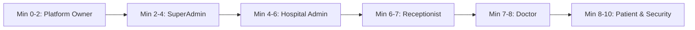

# MediConnect – 10-Minute Interactive Showcase Guide

**Environment:** Safe Local Demonstration Mode (Isolated SQLite Synthetic Database)  
**Target Platform:** MediConnect Healthcare Management Platform  
**Scope:** Complete Walkthrough of All Six Administrative & Clinical Roles  
**Data Safety Guarantee:** Runs 100% on synthetic local data (`backend/doctor_hospital.db`). **Zero connection to the production MySQL database.** No production patient or staff data is exposed.

---

## 1. Quick Start: Launching the Local Demo Environment

To run the safe showcase environment without touching the live MySQL database or production network:

### Step 1: Start the Backend in Demo Mode (Terminal 1)
```powershell
# Set safe SQLite demo override flag and start backend
$env:USE_SQLITE = "true"
$env:FLASK_ENV = "development"
python backend/app.py
```
*Expected Terminal Output:*
```text
[DB] Successfully connected using SQLITE
[DB] SQLite WAL mode successfully verified: WAL
[START] Doctor & Hospital Management API is running on http://127.0.0.1:5000
```

### Step 2: Start the Frontend Development Server (Terminal 2)
```powershell
npm --prefix frontend run dev
```
*Expected Terminal Output:*
```text
VITE v8.2.2 ready in 250 ms
➜  Local:   http://localhost:5173/
```

---

## 2. Demo Credentials Reference Table (Synthetic Data Only)

> [!NOTE]
> All credentials listed below are purely synthetic, offline demonstration accounts stored in `backend/doctor_hospital.db`. They do NOT correspond to live production secrets.

| Role | Role Tab on Login Page | Synthetic Demo Email | Synthetic Demo Password | Primary Dashboard Route | Scope of Authority |
| :--- | :--- | :--- | :--- | :--- | :--- |
| **1. Platform Owner** | `Platform Owner` (Red) | `owner@mediconnect.com` | `Owner@123` | `/owner` | Global ecosystem overview, all hospitals, SuperAdmin management, platform audit logs. |
| **2. SuperAdmin** | `SuperAdmin` (Orange) | `admin.hosp1@medicare.com` | `Admin@123` | `/superadmin` | Multi-hospital regional oversight (assigned to Hospital 1 & 2), admin history, hospital stats. |
| **3. Hospital Admin** | `Hospital Admin` (Navy) | `legacy.admin@medicare.com` | `Admin@123` | `/hospital-admin` | Single hospital administration (Hospital 1), doctor rosters, receptionist staff, utilization reports. |
| **4. Receptionist** | `Receptionist` (Violet) | `reception.hosp1@medicare.com`| `Reception@123` | `/admin` | Hospital 1 front-desk queue, walk-in registration, check-ins, appointment scheduling. |
| **5. Doctor** | `Doctor` (Teal) | `dr.one@medicare.com` | `Doctor@123` | `/doctor` | Clinical agenda, patient consultations, schedule management, digital prescription issuance. |
| **6. Patient** | `Patient` (Sky Blue) | `patient.alpha@test.com` | `Patient@123` | `/patient` | Hospital directory, doctor booking, personal appointments, digital prescription downloads. |

---

## 3. The 10-Minute Structured Showcase Script

Follow this precise chronological sequence to demonstrate the entire platform in 10 minutes:



---

### Minute 0:00 – 2:00: Act I — Platform Owner Ecosystem Oversight

1. **Navigate to:** `http://localhost:5173/login`.
2. **Select Role Tab:** Click **Platform Owner** (Shield Icon, Red accent).
3. **Login:** Enter `owner@mediconnect.com` and `Owner@123`.
4. **Demonstrate:**
   - **Ecosystem KPI Cards:** Show total registered hospitals, platform doctors, active superadmins, and overall consultations.
   - **Platform Audit Logs (`/owner/audit-logs`):** Highlight real-time immutable audit trail recording user logins, promotions, and status changes.
   - **SuperAdmin Assignment (`/owner/superadmins`):** Show how the Owner can assign SuperAdmins to supervise specific regional hospital clusters.
5. **Logout:** Click the top-right profile dropdown and select **Sign Out**.

---

### Minute 2:00 – 4:00: Act II — SuperAdmin Multi-Hospital Supervision

1. **Navigate to:** `http://localhost:5173/login`.
2. **Select Role Tab:** Click **SuperAdmin** (Hospital Symbol, Orange accent).
3. **Login:** Enter `admin.hosp1@medicare.com` and `Admin@123`.
4. **Demonstrate:**
   - **Assigned Hospital Switcher:** Show that this SuperAdmin supervises Hospital 1 (`Reliability General Hospital`) and Hospital 2.
   - **Hospital Overview & Stats:** Click into Hospital 1 to view capacity, active doctors, and appointment trends.
   - **Admin Governance (`/superadmin/hospital-admins`):** Inspect primary administrator assignment history and verification status.
   - **Security Highlight:** Point out that this SuperAdmin cannot inspect unassigned hospitals (e.g. Hospital 3).
5. **Logout:** Click **Sign Out**.

---

### Minute 4:00 – 6:00: Act III — Hospital Admin Single-Facility Operations

1. **Navigate to:** `http://localhost:5173/login`.
2. **Select Role Tab:** Click **Hospital Admin** (Hospital Icon, Navy accent).
3. **Login:** Enter `legacy.admin@medicare.com` and `Admin@123`.
4. **Demonstrate:**
   - **Facility Dashboard (`/hospital-admin`):** Review Hospital 1 specific operational statistics (5 Doctors, 3 Receptionists).
   - **Hospital Profile Immutability (`/hospital-admin/hospital-profile`):** Show that the registered legal name `Reliability General Hospital` is locked against unauthorized tampering.
   - **Doctors Management (`/hospital-admin/doctors`):** Inspect the roster of Cardiology doctors and verify specializations.
   - **Staff Management (`/hospital-admin/receptionists`):** Show how the Hospital Admin can activate or toggle receptionist accounts.
   - **Departmental Reports (`/hospital-admin/reports`):** Review consultation volumes and departmental utilization.
5. **Logout:** Click **Sign Out**.

---

### Minute 6:00 – 7:00: Act IV — Front-Desk Receptionist Triage & Check-In

1. **Navigate to:** `http://localhost:5173/login`.
2. **Select Role Tab:** Click **Receptionist** (Clipboard Icon, Violet accent).
3. **Login:** Enter `reception.hosp1@medicare.com` and `Reception@123`.
4. **Demonstrate:**
   - **Reception Queue (`/admin`):** View today's arrivals and pending patient appointments.
   - **Walk-in Registration (`/admin/patient-checkin`):** Show how walk-in patients without an existing account can be registered in under 30 seconds.
   - **Patient Check-In Action:** Click **Check-In** on an arriving patient to instantly notify the attending doctor.
   - **Tenant Protection:** Emphasize that the receptionist is restricted exclusively to Hospital 1.
5. **Logout:** Click **Sign Out**.

---

### Minute 7:00 – 8:30: Act V — Doctor Clinical Workspace & Digital Prescriptions

1. **Navigate to:** `http://localhost:5173/login`.
2. **Select Role Tab:** Click **Doctor** (Stethoscope Icon, Teal accent).
3. **Login:** Enter `dr.one@medicare.com` and `Doctor@123`.
4. **Demonstrate:**
   - **Doctor Agenda (`/doctor`):** Review today's consultation schedule and patient queue.
   - **Patient Consultation Review:** View clinical reason for visit and medical background.
   - **Digital Prescription Creation:** Open the digital prescription modal, add diagnosis (`Hypertension Check`), medication (`Amlodipine 5mg`), dosage instructions, and generate the signed digital prescription.
   - **Availability Management (`/doctor/schedule`):** Show how the doctor can adjust consultation working hours.
5. **Logout:** Click **Sign Out**.

---

### Minute 8:30 – 10:00: Act VI — Patient Booking & Security Boundary Drill

1. **Navigate to:** `http://localhost:5173/login`.
2. **Select Role Tab:** Click **Patient** (User Icon, Sky Blue accent).
3. **Login:** Enter `patient.alpha@test.com` and `Patient@123`.
4. **Demonstrate:**
   - **Hospital & Doctor Search (`/hospitals`):** Find `Reliability General Hospital`, select Dr. Rajesh Kumar, and pick an available future slot.
   - **Appointment Confirmation:** Confirm the appointment; navigate to **My Appointments** (`/patient/appointments`) to verify the booking.
   - **Prescription Retrieval (`/patient/prescriptions`):** Open the digital prescription issued by the doctor in Act V.
   - **Live Security Drill (Anti-IDOR Barrier):** Open browser address bar and attempt to navigate to `http://localhost:5173/owner` or `http://localhost:5173/hospital-admin`. Show that the platform immediately enforces access control and returns **403 Access Denied** / redirects to safety.
5. **Wrap Up:** Showcase bilingual toggle (English / Telugu) in the navigation bar to demonstrate full multilingual capability.

---

## 4. Resetting the Demonstration Environment

If changes were made during the demo (e.g. new test bookings or appointments) and you wish to return the demo database to a pristine baseline:

```powershell
# Restore SQLite demo database from initial snapshot
git checkout -- backend/doctor_hospital.db
```
The demo database instantly resets to its clean, verified 6-role state.
