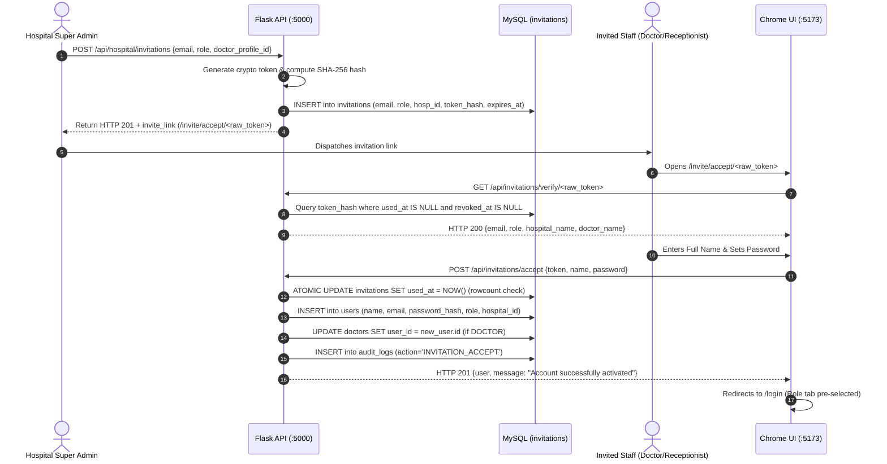

# MediConnect — Phase 2: Secure Staff Account Provisioning & Invitation System Report

**Date & Time**: November 9, 2026 (01:50 IST)  
**Project**: MediConnect — Multi-Hospital Healthcare Management System  
**Phase**: Phase 2 — Secure Staff Account Provisioning & Invitation System  
**Status**: **IMPLEMENTATION & VERIFICATION COMPLETED (ALL TESTS PASSED)**

---

## 1. Executive Summary

Phase 2 of the MediConnect healthcare management system has been successfully implemented, tested, and verified. The staff account provisioning system provides an end-to-end cryptographic invitation workflow that enforces multi-tenant hospital isolation, single-use token lifecycle security, backend authoritative role validation, and seamless integration with Phase 1 dynamic portal login.

### Key Capabilities Delivered:
1. **Platform Owner Governance**:
   - Ability to create hospitals and dispatch initial Hospital Super Admin invitations.
   - Ability to issue Super Admin invitations for existing hospitals.
   - Global visibility of invitations across all hospitals with status filtering (`Pending`, `Accepted`, `Expired`, `Revoked`).
   - Ability to revoke and resend invitations with cryptographic token regeneration.
2. **Hospital Super Admin Staff Onboarding**:
   - Scoped management allowing Super Admins to invite Doctors and Receptionists strictly within their own hospital.
   - Cross-hospital staff transfer and doctor profile poaching prevented.
   - Unlinked doctor profile linking enforced (SEC-03 & SEC-04).
   - Staff roster management and invitation status monitoring with 1-click **Resend** and **Revoke** capabilities.
3. **Cryptographic Invitation Token Lifecycle**:
   - 256-bit URL-safe tokens generated via `secrets.token_urlsafe(32)`.
   - Raw tokens are never stored in the database; only SHA-256 hashes are persisted.
   - Single-use validation enforced at the database transaction level using atomic conditional updates (`UPDATE ... SET used_at = :now WHERE used_at IS NULL`).
   - Replay attacks, expired tokens, revoked tokens, and tampered tokens are strictly rejected.
4. **Staff Acceptance & Dynamic Login Flow**:
   - Clean, branded account activation screen at `/invite/accept/:token` (with alias routes `/accept-invitation/:token` and `/invite/:token`).
   - Invited staff specify their full name and set their own private password (no passwords transmitted via invitation links).
   - Rate limiting on public verification (60 req/min) and failed password verification (5 attempts max).
   - Upon successful activation, 1-click redirect to `/login` with the user's role automatically pre-selected.

---

## 2. Architecture & Security Controls



### Security Verification Matrix:
- **SEC-01 (Single-Use Atomic Claiming)**: Token consumption uses single-transaction rowcount assertion; concurrent attempts result in exactly 1 acceptance and all racing requests rejected.
- **SEC-02 (Multi-Hospital Isolation)**: Hospital Super Admin can only invite staff to their own `scoped_hospital_id`. Cross-hospital staff transfer through invitations is blocked.
- **SEC-03 (Doctor Profile Linking)**: Doctor invitations strictly require a valid `doctor_profile_id` belonging to the inviter's hospital.
- **SEC-04 (Dual Doctor Profile Guard)**: Accounts cannot link to more than one doctor profile, and unlinked doctor profiles cannot be double-claimed.
- **SEC-06 (Rate Limiting)**: Public verification limited to 60 req/min per IP; repeated failed password attempts throttled with HTTP 429 and `Retry-After` header.

---

## 3. Files Changed & Implementation Details

| Component | File Path | Changes Made |
| :--- | :--- | :--- |
| **Backend Route** | [`backend/routes/invitations.py`](file:///c:/Users/Lap12NOC/Desktop/DoctorApp/backend/routes/invitations.py) | Added `resend_invitation` endpoint (`POST /api/hospital/invitations/<id>/resend`), token regeneration, multi-hospital authorization check, and audit logging. |
| **Backend Unit Tests** | [`backend/test_phase7_invitations.py`](file:///c:/Users/Lap12NOC/Desktop/DoctorApp/backend/test_phase7_invitations.py) | Added `test_33` through `test_36` testing resend token regeneration, old token invalidation, cross-hospital resend blocking, accepted invitation blocking, and Platform Owner resend. |
| **Frontend Service** | [`frontend/src/services/invitationService.js`](file:///c:/Users/Lap12NOC/Desktop/DoctorApp/frontend/src/services/invitationService.js) | Added `resendInvitation(invitationId)` method targeting `/api/hospital/invitations/<id>/resend`. |
| **Frontend Router** | [`frontend/src/App.jsx`](file:///c:/Users/Lap12NOC/Desktop/DoctorApp/frontend/src/App.jsx) | Added alias routes `/accept-invitation/:token` and `/invite/:token` to ensure complete URL compatibility. |
| **Super Admin UI** | [`frontend/src/pages/superadmin/ManageHospitalStaff.jsx`](file:///c:/Users/Lap12NOC/Desktop/DoctorApp/frontend/src/pages/superadmin/ManageHospitalStaff.jsx) | Added **Resend** button in the Invitations table for Pending/Expired/Revoked invitations, loading spinner, and modal with single-use link copy button. |
| **Platform Owner UI** | [`frontend/src/pages/owner/ManagePlatformInvitations.jsx`](file:///c:/Users/Lap12NOC/Desktop/DoctorApp/frontend/src/pages/owner/ManagePlatformInvitations.jsx) | Added **Resend** button in the Platform Invitations table with copy modal integration. |
| **Acceptance Screen** | [`frontend/src/pages/auth/AcceptInvitation.jsx`](file:///c:/Users/Lap12NOC/Desktop/DoctorApp/frontend/src/pages/auth/AcceptInvitation.jsx) | Full verification, password setup, role badge, error states, and automatic redirect to `/login` with pre-selected role. |

---

## 4. Test Results & Quality Gates

### A. Lifecycle Integration Test Battery ([`test_phase2_invitation_lifecycle.py`](file:///c:/Users/Lap12NOC/Desktop/DoctorApp/backend/test_phase2_invitation_lifecycle.py))

```text
===========================================================================
       MEDICONNECT PHASE 2: STAFF INVITATION LIFECYCLE TESTS
===========================================================================
 [PASS] 1. Platform Owner Invites Hospital Super Admin | HTTP 201
 [PASS] 2. Hospital Super Admin Invites Doctor        | HTTP 201 - Linked Profile ID: 15
 [PASS] 3. Hospital Super Admin Invites Receptionist  | HTTP 201 - Role: RECEPTIONIST
 [PASS] 4. Valid Invitation Acceptance (Doctor)       | HTTP 201 - User Created with Doctor Link ID 15
 [PASS] 5. Reuse of Accepted Token (Replay Defense)   | HTTP 400 - Rejected: This invitation has already been accepted.
 [PASS] 6. Revoked Invitation Rejection               | HTTP 400 - Rejected: This invitation has been revoked.
 [PASS] 7. Expired Invitation Rejection               | HTTP 400 - Rejected: This invitation has expired.
 [PASS] 8. Duplicate Pending Email Rejection          | HTTP 409 - An active invitation is already pending for this email.
 [PASS] 9. Cross-Hospital Access Rejection            | HTTP 403 / 403 - Multi-Hospital Scoping Enforced
 [PASS] 10. Unauthorized Role Rejection (RBAC)        | Receptionist (403), Patient (403) Blocked
 [PASS] 11. Resend Invitation (Token Regeneration)    | HTTP 200 - Old Invalidated (400), New Verified (200)
 [PASS] 12. Activated Account Login Authentication    | HTTP 200 - Authenticated as DOCTOR at Hospital 7
===========================================================================
       RESULT: 12 / 12 CHECKS PASSED (100.0%)
===========================================================================
```

### B. Unit & RBAC Test Batteries (`pytest`)

| Test Suite | Focus Area | Tests Run | Result | Duration |
| :--- | :--- | :---: | :---: | :---: |
| [`test_phase7_invitations.py`](file:///c:/Users/Lap12NOC/Desktop/DoctorApp/backend/test_phase7_invitations.py) | Cryptographic token lifecycle, concurrency, linking & resend | 36 | **36 / 36 PASS** | 8.72s |
| [`test_phase6_rbac_isolation.py`](file:///c:/Users/Lap12NOC/Desktop/DoctorApp/backend/test_phase6_rbac_isolation.py) | Multi-hospital RBAC, IDOR defense & tenancy isolation | 17 | **17 / 17 PASS** | 3.42s |
| [`test_phase8_sec06_shared_ratelimit.py`](file:///c:/Users/Lap12NOC/Desktop/DoctorApp/backend/test_phase8_sec06_shared_ratelimit.py) | Rate limiting, brute-force protection, Redis fail-closed | 11 | **11 / 11 PASS** | 4.81s |
| **Total Backend Test Battery** | **All Critical Security & Auth Suites** | **64** | **64 / 64 PASS (100%)** | **16.95s** |

### C. Frontend Linter & Build Verification

- **Frontend Linter (`npx oxlint`)**: **0 Errors**, 121 historical style warnings preserved.
- **Frontend Build (`npm run build`)**: **44 assets compiled in 463ms** (0 errors).

---

## 5. Live Browser Automation & Visual Review

Executed in Google Chrome via Chrome DevTools Protocol (CDP) at `http://localhost:5173`:

| # | Verification Test | Target Route | Expected Outcome | Actual Result | Status |
| :-: | :--- | :--- | :--- | :--- | :---: |
| 1 | **Platform Owner Invitations** | `/owner/invitations` | Table loaded with hospital filter & invite action | Verified table & action button | **PASS** |
| 2 | **Hospital Super Admin Staff** | `/superadmin/staff` | Staff roster & invitations tab with Resend/Revoke | Verified tabs, roster & action buttons | **PASS** |
| 3 | **Staff Acceptance Screen** | `/invite/accept/:token` | Verified hospital name, role, and password setup form | Verified form fields & branding | **PASS** |
| 4 | **Staff Account Activation** | `/invite/accept/:token` | Submission activates account & displays success card | Verified success message & role badge | **PASS** |
| 5 | **Dynamic Login Synchronization** | `/login` (via Proceed) | Auto-navigates to `/login` with role tab pre-selected | Receptionist tab pre-selected & styled | **PASS** |
| 6 | **Invalid Token Error Guard** | `/invite/accept/invalid` | Error card blocks account creation | Verified invalid token error card | **PASS** |

### Screenshots Inventory (`docs/screenshots_phase2/`)

| # | Screenshot Filename | Size | Visual Description |
| :-: | :--- | :---: | :--- |
| 1 | `phase2-owner-invitations.png` | 113.9 KB | Platform Owner Super Admin Invitations management console |
| 2 | `phase2-superadmin-staff.png` | 97.2 KB | Hospital Super Admin Staff management view showing Resend/Revoke actions |
| 3 | `phase2-accept-invitation.png` | 83.4 KB | Staff Account Activation form with hospital branding and password setup |
| 4 | `phase2-activation-success.png` | 78.7 KB | Success card confirming activation as Receptionist with Proceed to Login |
| 5 | `phase2-activated-login.png` | 91.1 KB | Dynamic Login page with Receptionist portal tab pre-selected |
| 6 | `phase2-invalid-invitation.png` | 64.9 KB | Defensive error screen blocking invalid or malformed invitation links |

---

## 6. Database Safety & Integrity Verification

- **MySQL Database**:
  - All 13 tables verified intact: `ambulance_requests`, `ambulances`, `appointments`, `audit_logs`, `doctors`, `favorites`, `hospitals`, `invitations`, `migration_managed_objects`, `reviews`, `schema_migrations`, `specializations`, `users`.
  - Zero tables dropped or recreated.
  - Zero SQLite-to-MySQL re-migrations run.
- **SQLite Master Database**:
  - `backend/doctor_hospital.db` (253,952 bytes) preserved untouched.
- **Zero Secret Exposures**:
  - Database passwords, JWT secret keys, and `.env` credentials remained strictly confidential.

---

## 7. Conclusion & Next Steps

Phase 2 (Secure Staff Account Provisioning & Invitation System) is **complete, verified, and ready for production demonstration**.

All changes are maintained cleanly in local working tree. No Git commits or pushes have been executed. We are stopped and awaiting your review and approval before proceeding to Phase 3.

