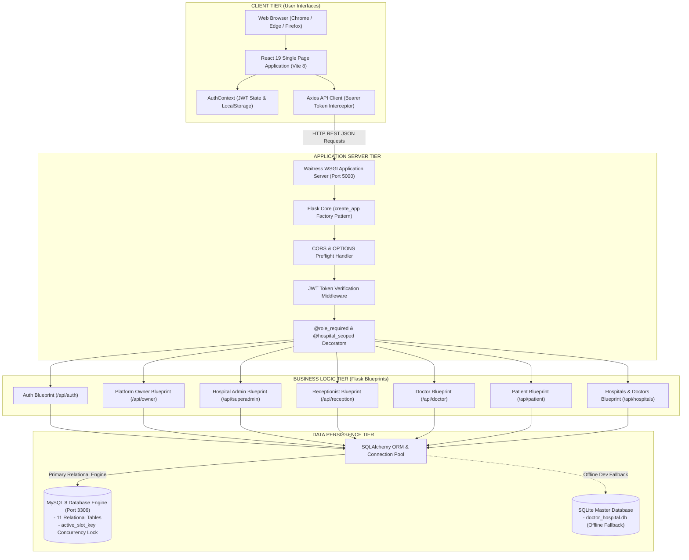
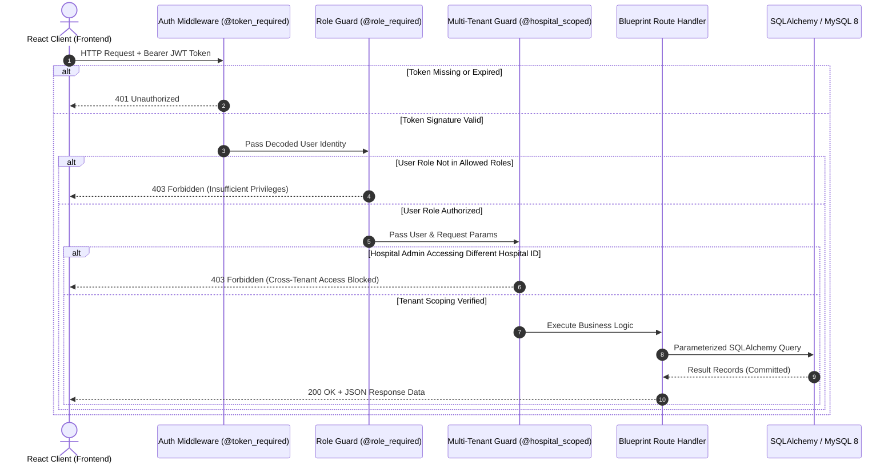
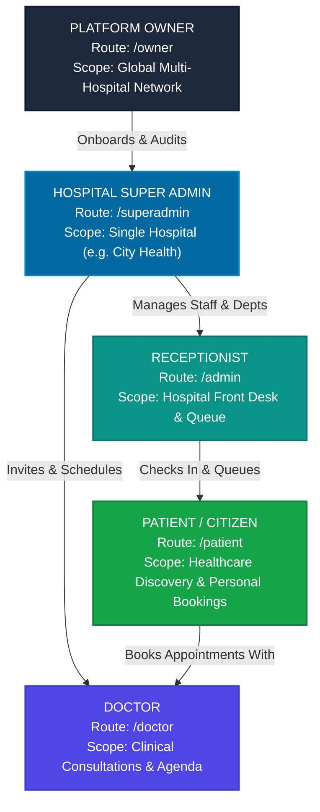

# MediConnect — Project Architecture & Technical Design

**Project Name:** MediConnect Multi-Hospital Healthcare Management System  
**Document Purpose:** Clear technical architecture explanation for project evaluation, engineering seminars, and viva examination.  
**Stack Overview:** React 19 SPA + Vite 8 + Python 3.11 + Flask WSGI + SQLAlchemy ORM + MySQL 8.

---

## 1. High-Level System Architecture Diagram

---

## 2. Tier-by-Tier Architectural Explanation

### Tier 1: Client Tier (Frontend SPA)
The client tier is built as a decoupled **Single Page Application (SPA)** using **React 19** and bundled with **Vite 8**.
- **Client-Side Routing (`react-router-dom`)**:
  - The client routing is managed entirely in the browser. When a user clicks a navigation link, React Router swaps the active view in the DOM without triggering a full page reload from the web server.
  - Route guards (`<ProtectedRoute>` and `<RoleRoute>`) intercept unauthorized attempts to access internal dashboards and redirect unauthenticated users to `/login`.
- **State Management (`AuthContext`)**:
  - User session state (user profile, role, hospital affiliation, and JWT token) is centralized in a React Context provider.
  - Session data is persisted to `localStorage` under keys `medicare_token` and `medicare_user`, enabling session persistence across browser refreshes.
- **API Communication (`services/api.js`)**:
  - An Axios instance with a global request interceptor attaches the `Authorization: Bearer <token>` header to all outgoing HTTP requests automatically.
  - Global response interceptors detect HTTP 401 Unauthorized errors (such as expired tokens) and trigger clean automatic logouts.
- **Performance Optimization (Code Splitting)**:
  - All five role-based portals (`OwnerDashboard`, `SuperAdminDashboard`, `ReceptionDashboard`, `DoctorDashboard`, `PatientDashboard`) are imported dynamically using `React.lazy()` and `<Suspense>`, reducing initial bundle size and speeding up first-contentful paint.

---

### Tier 2: Application Server Tier (Flask & Waitress WSGI)
The application tier runs a modular **Python 3.11** REST API built on **Flask**:
- **Production WSGI Serving (Waitress)**:
  - On Windows, Flask's single-threaded development server is replaced by **Waitress WSGI**, a robust, multi-threaded application server running with 4 concurrent worker threads (`--threads=4`).
- **Application Factory Pattern (`create_app()`)**:
  - Application initialization is encapsulated inside `create_app()` in `backend/app.py`. This pattern simplifies test execution, configuration isolation, and database connection pooling.
- **Security & Preflight Middleware**:
  - **CORS Handling**: Validates incoming `Origin` headers against an approved whitelist (`localhost:5173`, `127.0.0.1:5173`), preventing unauthorized third-party domains from querying the API.
  - **OPTIONS Preflight**: Intercepts preflight requests before route processing and returns required CORS headers with a 24-hour cache max-age (`Access-Control-Max-Age: 86400`).

---

### Tier 3: Business Logic & Access Control Tier
Business logic is divided into modular domain Blueprints, each protected by custom Python decorators:

#### Key Decorators:
1. **`@token_required`**: Decodes the JWT signature using the server's private `SECRET_KEY`, verifying expiration (`exp`) and extracting `user_id`.
2. **`@role_required(allowed_roles)`**: Compares the user's role against the endpoint's permitted roles (e.g., rejecting a patient trying to access `/api/owner/hospitals`).
3. **`@hospital_scoped`**: Extracts the administrator's `hospital_id` and automatically appends `.filter_by(hospital_id=current_user.hospital_id)` to database queries, guaranteeing cross-hospital data privacy.

---

### Tier 4: Data Persistence Tier (MySQL 8 & SQLAlchemy)
The persistence tier provides relational integrity, high concurrency, and data safety:
- **Primary Database Engine (MySQL 8)**:
  - Running on standard port 3306, managed via `PyMySQL` driver.
  - Connection pooling with `pool_size=10` and `pool_recycle=1800` prevents socket exhaustion under heavy loads.
- **Core Relational Entities**:
  - `users`: Core authentication identity, role, and hospital link.
  - `hospitals`: Multi-hospital facility registry.
  - `doctors`: Clinical practitioner profiles linked to hospitals and specializations.
  - `appointments`: Patient consultation bookings.
  - `ambulance_requests`: Emergency ambulance dispatches.
  - `audit_logs`: Immutable security audit log.
- **Deterministic Concurrency Lock (`active_slot_key`)**:
  - In the `appointments` table, a stored generated column computes:
    `active_slot_key = CONCAT(doctor_id, '_', appointment_date, '_', appointment_time)` (when `status != 'Cancelled'`).
  - A database **Unique Index** on `active_slot_key` mathematically prevents two patients from booking the same doctor slot at the same minute, avoiding double-booking race conditions.
- **Offline Fallback Engine (SQLite)**:
  - A verified SQLite master database (`doctor_hospital.db`, 253 KB) is maintained. If MySQL is unreachable, the backend automatically falls back to SQLite, allowing development on laptops without MySQL Server.

---

## 3. Five-Tier Role-Based Portal Architecture

MediConnect structures user permissions into five distinct privilege tiers:

| Portal Tier | Base Route | Key Screens & Capabilities | Enforced Isolation Boundary |
| :--- | :--- | :--- | :--- |
| **Platform Owner** | `/owner` | System metrics, multi-hospital registry (`/owner/hospitals`), audit logs (`/owner/audit-logs`). | Global read/write across all network entities; cannot be restricted by `hospital_id`. |
| **Hospital Super Admin** | `/superadmin` | Hospital command center, department setup, doctor directory, staff roster (`/superadmin/staff`). | Strictly scoped to their own hospital; cross-hospital reads/writes rejected with HTTP 403. |
| **Receptionist** | `/admin` | Front-desk queue, patient search, rapid check-in (`/admin/check-in`), doctor on-duty status. | Scoped to hospital front-desk queue; zero access to clinical consultation notes or financials. |
| **Doctor** | `/doctor` | Daily agenda, assigned patient consultations (`/doctor/appointments`), availability schedule (`/doctor/schedule`). | Scoped strictly to their own assigned patients; cannot inspect other doctors' clinical notes. |
| **Patient** | `/patient` | Healthcare hub, upcoming consultations, doctor search (`/doctors`), emergency ambulance (`/emergency`). | Scoped to own medical records; can book across any hospital in the network. |

---

## 4. Key Architectural Strengths to Highlight in Viva

1. **Stateless Scalability**: The backend retains no server-side session memory. Each request is authenticated independently via cryptographic JWT signatures, allowing the backend to scale across multiple instances behind a load balancer.
2. **Deterministic Race Condition Prevention**: Concurrency control is enforced at the database engine level via unique constraints on generated keys, eliminating application-level race windows.
3. **Defense-in-Depth Security**: Authentication checks occur across three independent layers (CORS preflight -> JWT signature verification -> `@hospital_scoped` query injection), ensuring zero cross-tenant data leakage.
4. **Reproducible Tooling**: Pre-flight verification scripts (`check_demo_prerequisites.py`) and graceful shutdown scripts (`stop_demo.py`) ensure the demonstration starts and terminates cleanly without leaving orphan processes or hanging ports.

